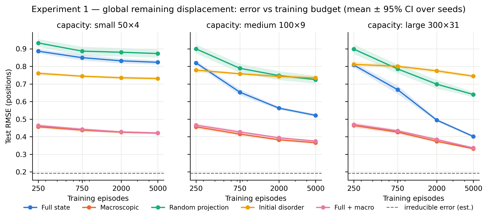
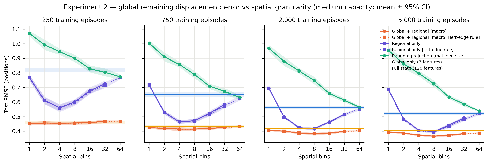
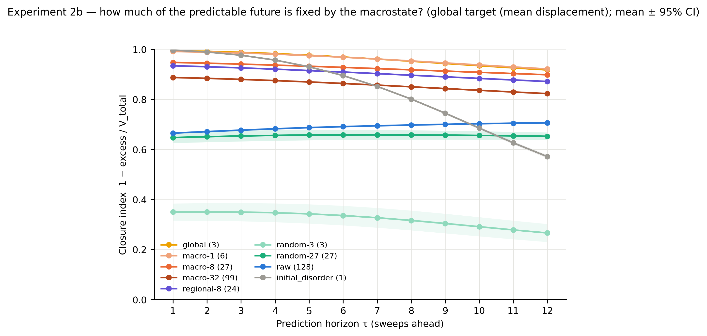

# Predictive Abstraction

**Learning what matters: from information compression and emergence to intelligence.**

An open research project exploring whether useful abstractions can make complex systems easier to predict, how those abstractions relate to emergent structure, and whether they can eventually be discovered and transferred by artificial intelligence.

We start with small, reproducible experiments comparing microscopic and macroscopic representations under limited data and computational resources.

[Read the essay](https://giorgiosavastano.github.io/predictive-abstraction/) · [Methods](docs/methods.md) · [Working research note](docs/manuscript-draft.md)

> **Status: controlled multi-seed results (10 seeds), one learner family.** The macroscopic variables are hand-engineered and know the sorting objective; these experiments test *supplied* abstractions, not autonomous abstraction learning. The simulator is inspired by, **not a replication of**, the self-sorting systems in Zhang, Goldstein & Levin (2025).



## Quick start

Requires [uv](https://docs.astral.sh/uv/) and Python 3.13 (`.python-version`).

```bash
uv sync                      # install the locked environment

# One-minute demo: 2 seeds, 2 budgets, small/medium models, 1/8/64 bins -> results/quick/
uv run macro-experiment1 --quick && uv run macro-experiment2 --quick
uv run macro-analyze --experiment1 results/quick/experiment1 --experiment2 results/quick/experiment2 --paper-figures ""

uv run pytest                # 23 tests, ~1 min

# Original single-seed baseline (writes to a git-ignored directory)
uv run macro-prediction --output results/runs/reproduction

# Experiment 1: 10 seeds x 4 budgets x 4 capacities x 5 representations x 2 tasks  (~35 min)
uv run macro-experiment1 --output results/experiment1

# Experiment 2: granularity sweep 1-64 bins, ablations, matched projections   (~27 min)
uv run macro-experiment2 --output results/experiment2

# Experiment 2b: learner-free closure test of the macroscopic variables      (~10 min)
uv run macro-experiment2b --output results/experiment2b

# Aggregate, plot, copy figures to paper/figures, and regenerate the blog figures in docs/figures
uv run macro-analyze --experiment1 results/experiment1 --experiment2 results/experiment2 \
    --experiment2b results/experiment2b --blog-figures docs/figures

# Rebuild the simulator walkthrough only (one illustrative trajectory, no experiment rerun)
uv run python scripts/render_simulator.py
```

Both experiment runners are resumable (finished configurations are skipped on re-run) and accept `--seeds`, `--budgets`, `--capacities` / `--capacity`, `--bins`, `--n-val`, `--n-test` and `--output`; see `--help`. Timings are for a 10-core Apple Silicon laptop.

## The system and the question

An array of **64 unique elements** is disturbed from sorted order; neighbouring exchanges succeed stochastically, with one spatially localized fault interval where they often fail. From the initial permutation and the reliability profile we predict the **mean absolute displacement after 12 sorting sweeps** (global task). A deliberately local control target, the value at the centre cell after one sweep, checks that no representation is best for every question.

| Representation | Features | Description |
| :-- | --: | :-- |
| Full state | 128 | 64 normalized values + 64 edge reliabilities |
| Macroscopic | 3 + 3·B | 3 global summaries (mean displacement, descent fraction, displacement × unreliability) + 3 per spatial bin; B = 8 by default |
| Random projection | 3 + 3·B | Seeded Gaussian projection of the standardized full state (fitted on training rows only) |
| Initial disorder | 1 | Mean normalized displacement |
| Full + macro | 128 + 3 + 3·B | Diagnostic concatenation |

Learner: `HistGradientBoostingRegressor` with presets small (50 trees × 4 leaves), medium (100 × 9, the baseline), large (300 × 31) and xlarge (1,000 × 63). Capacity is chosen on a separate validation split; test data are never used for selection. Full protocol: [`docs/methods.md`](docs/methods.md).

## Main results (10 seeds, mean ± SD; test RMSE in positions, lower is better)

**Experiment 1 — the advantage is real, consistent, and shrinks with resources.** Global task, validation-selected capacity:

| Training episodes | Full state | Macroscopic | Random projection | Initial disorder | Macro − Full (95% CI) |
| --: | --: | --: | --: | --: | :-- |
| 250 | 0.807 ± 0.020 | **0.455 ± 0.014** | 0.897 ± 0.036 | 0.760 ± 0.016 | −0.353 [−0.369, −0.337] (−44%) |
| 750 | 0.653 ± 0.024 | **0.415 ± 0.012** | 0.784 ± 0.034 | 0.744 ± 0.009 | −0.238 [−0.257, −0.220] (−36%) |
| 2,000 | 0.494 ± 0.012 | **0.375 ± 0.012** | 0.699 ± 0.035 | 0.735 ± 0.013 | −0.120 [−0.134, −0.106] (−24%) |
| 5,000 | 0.401 ± 0.010 | **0.332 ± 0.007** | 0.641 ± 0.020 | 0.731 ± 0.013 | −0.070 [−0.079, −0.060] (−17%) |

Macro beats the full state in all 130 seed × budget × capacity cells. Estimated irreducible RMSE of the target: 0.192 ± 0.003, so both curves remain above the floor and the raw-state curve is still falling. Random projections have higher mean error than the summary and full state at every tested budget and capacity; they do not always lose to the one-number reference. Adding the raw state to the summary did not improve mean error in these settings. A cost/error comparison also favours the summary: macro at the medium preset (0.31 s, RMSE 0.366) beats the full state at the large preset (4.06 s, RMSE 0.401). These are measured timings on one machine, not training runs at an identical time limit. On the **local control task** the ranking inverts in 10/10 seeds (full state 3.41 vs. macro 4.76 at 5,000 examples, medium, in element-value units). Details: [`results/experiment1/README.md`](results/experiment1/README.md).

**Experiment 2 — a shallow optimum at 8–16 bins, but the benefit is mostly the engineered global statistics.** Global task, medium preset, 5,000 episodes:

| Spatial bins | 1 | 2 | 4 | **8** | 16 | 32 | 64 | global only (3) | raw (128) |
| :-- | --: | --: | --: | --: | --: | --: | --: | --: | --: |
| Macro (global + regional) | 0.394 | 0.387 | 0.372 | **0.366** | 0.373 | 0.383 | 0.387 | 0.405 | 0.521 |
| Regional only | 0.684 | 0.484 | 0.407 | **0.397** | 0.441 | 0.492 | 0.519 | | |
| Random projection, same size | 0.955 | 0.861 | 0.797 | 0.725 | 0.634 | 0.585 | 0.538 | | |



At 250 examples the resolution differences are small (0.45–0.47) and 1 bin is often the validation-best choice; the optimum moves finer as data and capacity grow (8–16 bins at the large preset). Three global numbers reach an error about 11% above the best medium model, and permutation importance is dominated by the displacement × unreliability interaction. Even the 64-bin engineered representation (195 features, a larger encoding bound than the raw state) beats the raw state by 26%. The regional-only ablation shows the clearest resolution effect: 4–8 bins beat 64 bins by about 0.12 RMSE despite having fewer features. The local task generally benefits from finer regions, with 32 or 64 bins selected on validation data in all ten seeds. Details: [`results/experiment2/README.md`](results/experiment2/README.md).

**Experiment 2b — supplied global summaries capture regularities in average recovery without a learner.** Match configurations with similar summaries, simulate each forward 16 times, and compare their average futures. The closure index estimates agreement in conditional means after correcting for simulation noise; it does not compare full future distributions. Configurations start after two recovery sweeps. At 12 further sweeps, using 10,000 configurations per seed and 10 seeds (1 = no residual disagreement in conditional means in this diagnostic):

| Abstraction | Features | Closure | Matched-size random projection |
| :-- | --: | --: | --: |
| Initial disorder | 1 | 0.572 | |
| **Global summaries** | 3 | **0.918 ± 0.004** | 0.266 |
| Macro (8 bins) | 27 | 0.899 (matching limited) | 0.653 |
| Raw state | 128 | 0.706 (matching limited) | |



Re-ranking the matched configurations by microscopic detail raises the index by 0.0103 over random re-ranking; the previous round’s summary raises it by 0.0015. The history effect is small but nonzero, and one tested history depth does not establish Markovian dynamics. The disorder scalar alone gives high agreement at one sweep but less at twelve. Nearest-neighbour matching becomes less accurate in higher dimensions; the full-state estimate is still rising in the sample-size checks. Those estimates should not be read as evidence that a summary contains more information, or as rigorous bounds on dynamical closure. The result supports approximate conditional-mean closure for these observables, configurations and horizons, not a general autonomous macroscopic law or causal emergence. Details: [`results/experiment2b/README.md`](results/experiment2b/README.md).

**What this does and does not show.** Supported: a task-relevant *supplied* representation improves this learner’s global prediction under the tested data and capacity limits, with the largest advantage at small budgets; a separate observational diagnostic finds close agreement in average futures when configurations are matched on the global summaries. Not supported: an information gain, a general autonomous or Markov macroscopic law, causal emergence, or autonomous abstraction discovery. The local-task learning control reverses the representation ranking; predictive closure of the local target was not tested.

## The broader programme

The experiments are the first step of a progression we want to study: **compression → abstraction → generalization → transfer and adaptation.** The working hypothesis is that an important mechanism of intelligent behaviour is the capacity to discover, reuse and revise task-relevant abstractions: to identify which distinctions matter for the current objective, keep the relationships among them, discard the rest, and change that choice when the task changes. A companion hypothesis says where good abstractions often come from: **some emergent macroscopic properties of a system are particularly useful targets for abstraction because they capture stable, predictive relationships among its parts**, the way pressure and velocity capture a fluid. Emergence (a property of the system) and abstraction (a property of the observer's description) are kept distinct throughout. Experiments 1–2 test the usefulness of supplied variables to a learner; Experiment 2b separately tests approximate agreement in conditional-mean futures. Neither establishes a general autonomous macroscopic law.

The programme has four stages, laid out with their status in [`docs/research-vision.md`](docs/research-vision.md): (1) useful supplied abstraction, supported here in one system; (2) emergent predictive structure, investigated through the narrower conditional-mean diagnostic in Experiment 2b; (3) autonomous abstraction discovery; (4) transfer and adaptation. Stages 3–4 are proposed with minimal falsification tests and have not been started. The manuscript's related-work section places the hypotheses relative to Chollet's skill-acquisition efficiency, Gentner's structure-mapping, Abel's theory of abstraction in reinforcement learning, the information bottleneck, computational mechanics and the coarse-graining literature; they are a synthesis of those ideas, not a new theory.

## Results layout

| Directory | Contents |
| :-- | :-- |
| [`results/baseline/`](results/baseline/) | Frozen original single-seed run (seed 20261106, 8 bins); never modified |
| [`results/manual-seed123-bins16/`](results/manual-seed123-bins16/) | Copy of the manual `--seed 123 --bins 16` run with a provenance note (not a controlled comparison) |
| [`results/experiment1/`](results/experiment1/) | Raw per-fit records, summary CSVs, `tables.md`, figures, README |
| [`results/experiment2/`](results/experiment2/) | Same for the granularity sweep |
| [`results/experiment2b/`](results/experiment2b/) | Closure-test records (per abstraction, horizon, sample size), summaries, figures, README |

All numbers in the documentation are copied from `results/experiment*/summary/tables.md`, regenerated by `macro-analyze` from the raw JSON-lines records. See [`results/README.md`](results/README.md).

## Reproducibility notes

- Every random stream is `default_rng(seed + offset)` with documented offsets ([`docs/methods.md`](docs/methods.md) §5; offsets 30–32 for Experiment 2b); seeds must be ≥ 100 apart and the CLI enforces this.
- Training budgets are nested prefixes of a per-seed pool; all representations and capacities see identical episodes. The random projection's standardizer is fitted on the budget's training subset only (a correction to the baseline, which used the whole pool; it changes only the baseline's random-projection numbers below 5,000 examples, by ≤ 0.03).
- The refactored code reproduces `results/baseline/*.csv` exactly, and the new pipeline reproduces the baseline at the 5,000 budget with the baseline seed.
- `metadata.json` in each experiment directory records the command line, configuration, package versions and platform of every invocation.
- Timings are single-machine wall-clock numbers under default OpenMP threading.

## Writing

- [`docs/manuscript-draft.md`](docs/manuscript-draft.md) and [`paper/main.tex`](paper/main.tex): the research note (synchronized; not submission-ready, see its limitations section). It keeps the empirical contribution central, with the abstraction-based-intelligence hypothesis as motivation, discussion and future work.
- [`docs/index.md`](docs/index.md): the essay for technically curious readers, from Borges's Funes and the Library of Babel through coarse-graining in physics to the experiments and the open questions. It is the front page of the GitHub Pages site: in the repository settings choose *Pages → Deploy from a branch → folder `/docs`*, and the essay is served with its figures from [`docs/figures/`](docs/figures/).
- [`docs/research-vision.md`](docs/research-vision.md): the four-stage programme, what is established, what is hypothesis, and what would make us abandon it.
- [`docs/methods.md`](docs/methods.md): exact protocol. [`docs/next-experiments.md`](docs/next-experiments.md): status of the experiment plan and what is still missing (locality-aware raw-state baselines; extensions of the completed closure diagnostic; learned representations).

Scientific questions, reproducibility reports and focused patches are welcome; see [CONTRIBUTING.md](CONTRIBUTING.md). Software citation metadata is in [CITATION.cff](CITATION.cff); the working manuscript has no DOI or arXiv identifier.

## Repository layout

```text
.
├── src/macro_prediction/
│   ├── simulator.py      # Episodes, sweeps, targets, noise-floor estimate
│   ├── features.py       # Raw, global, regional, macro, random projection, size proxies
│   ├── models.py         # Capacity presets, timed fit/evaluate, model size
│   ├── data.py           # Per-seed splits and documented random streams
│   ├── experiment.py     # Original single-run CLI (macro-prediction), behaviour preserved
│   ├── experiment1.py    # macro-experiment1
│   ├── experiment2.py    # macro-experiment2
│   ├── experiment2b.py   # macro-experiment2b (learner-free closure test)
│   ├── analysis.py       # macro-analyze: summaries, paired stats, tables, figures
│   ├── plots.py          # Figure code
│   ├── stats.py          # Across-seed summaries and paired comparisons
│   └── store.py          # Resumable JSONL result store with metadata
├── tests/                # 23 tests: invariants, determinism, resumability, end-to-end CLIs
├── results/              # baseline, manual run, experiment1, experiment2, experiment2b
├── paper/                # LaTeX source, references, figures
├── docs/                 # methods, next experiments, manuscript, blog essay (index.md) + Pages config
└── pyproject.toml        # uv-managed project; scripts macro-prediction, macro-experiment1/2, macro-analyze
```

## References

1. Zhang, T., Goldstein, A., & Levin, M. (2025). Classical sorting algorithms as a model of morphogenesis. *Adaptive Behavior*, 33(1), 25–54. [DOI:10.1177/10597123241269740](https://doi.org/10.1177/10597123241269740)
2. Tishby, N., Pereira, F. C., & Bialek, W. (1999). The information bottleneck method. [arXiv:physics/0004057](https://arxiv.org/abs/physics/0004057)
3. Shalizi, C. R., & Crutchfield, J. P. (2001). Computational mechanics: Pattern and prediction, structure and simplicity. *J. Stat. Phys.*, 104, 817–879.

The full bibliography is in [`paper/references.bib`](paper/references.bib).

## License

MIT. See [LICENSE](LICENSE). No affiliation with, or endorsement by, the original paper's authors is implied.
