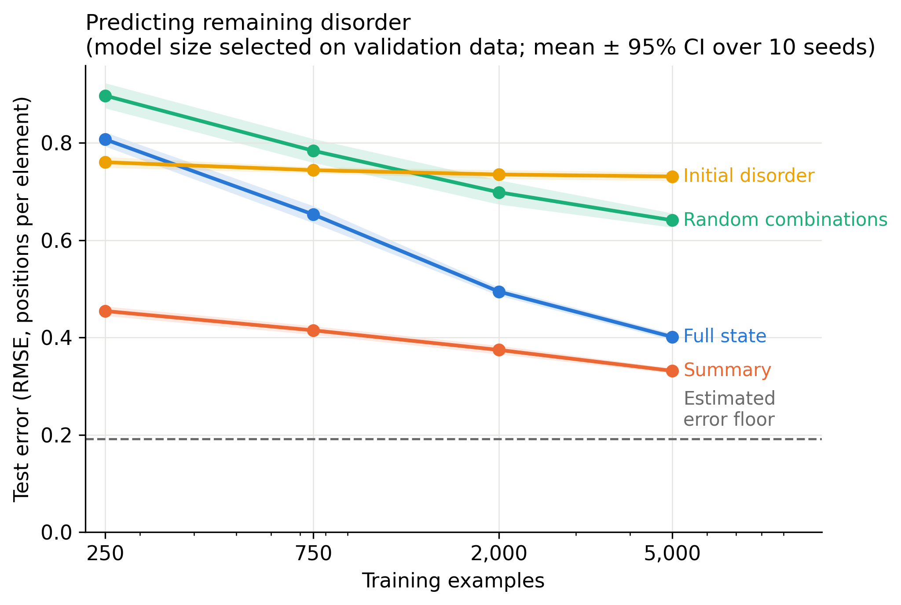
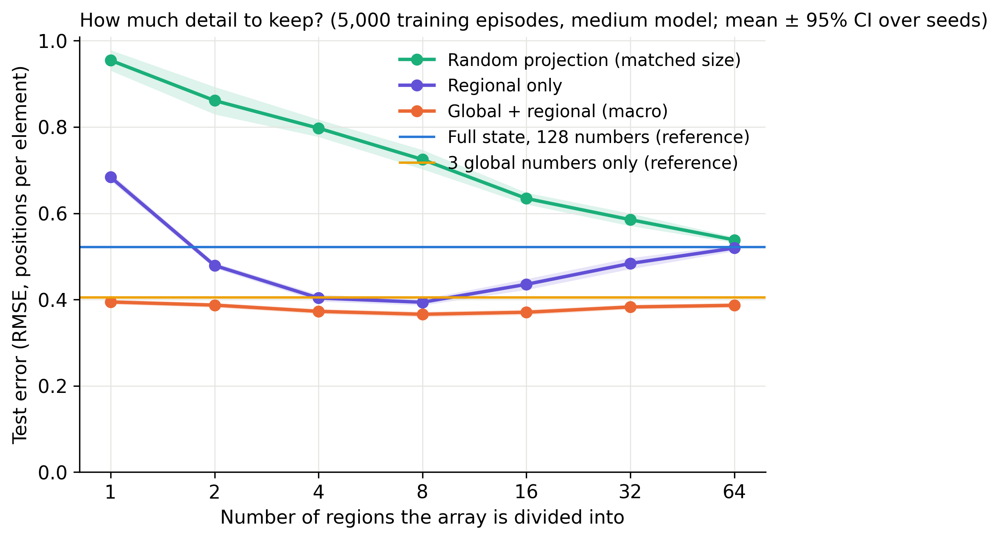
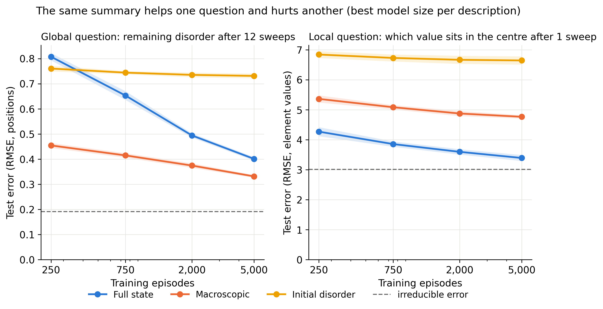
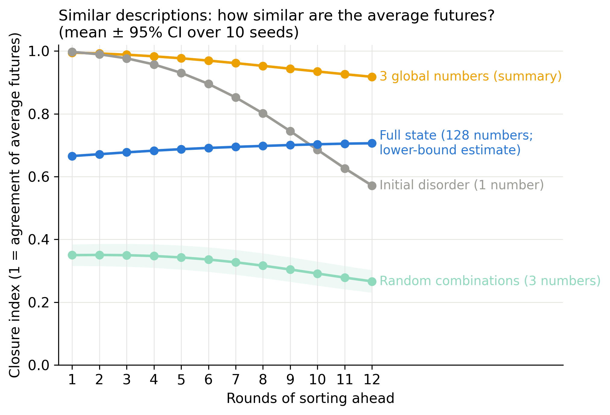

# The Art of Forgetting: From Borges to a Hypothesis About Intelligence

*6 November 2026. Code, raw results and the research note are in [the repository]({{ site.github.repository_url }}). The README explains how to reproduce the experiments and figures; a one-minute demo is also available there.*

## 1. The man who remembered everything

In 1942, Borges wrote a story that has stuck with me for more than 20 years. The story is about a young man in Uruguay, Ireneo Funes, who falls from a horse and wakes with a perfect memory. What may sound at first like an incredible superpower is quickly revealed to be an almost diabolic problem. Funes's superhuman lossless memory, while it allows him to remember every single detail of every second of his life, every leaf he ever witnessed, also effectively blocks him from forgetting any useless detail, to the point that he is not able to generalize or create abstract concepts. Funes finds it hard to accept that the dog seen at 3:14 from the side has the same name as the dog seen at 3:15 from the front.

From this first story, I want you to take home the importance of forgetting, of compressing information down to useful abstractions.

## 2. Information is not understanding

The year before, Borges wrote another story, called *The Library of Babel*. This story has recently been mentioned in connection with the wave of AI-generated content flooding the internet. The story is about a library that contains all possible books of 410 pages, created by forming all possible combinations of a fixed set of characters. In that sense, this imaginary library contains every book that has been or will ever be written in those characters: longer books could be divided across several volumes. It contains all useful knowledge, from a cure for cancer to the origin of the universe. However, it also contains a huge amount of nonsense, contradictions and misleading claims. It contains proofs, absurd claims and everything in between, including arguments for everything and the opposite of everything. The fictional people living in this strange universe quickly abandon their original excitement at the thought that they could find any information they might need, and fall into a state of despair fed by the fact that all this information is effectively unusable and their search is pointless.

Here we are going to borrow the distinction between the existence of information and its accessibility.

## 3. Abstraction and compression in physics

There is a recent [video by 3Blue1Brown, *Reinventing Entropy*](https://www.youtube.com/watch?v=l6DKRf-fAAM) exploring the mathematics of compression as part of a series connecting it to how AI systems learn. The thought-provoking and attention-grabbing idea behind the series is that intelligence is compression. My idea is somewhat adjacent to this one, as finding abstractions can be seen as an information compression process: ignoring what is not useful and keeping only what is. We find examples of these useful compressions everywhere in the laws of physics that we use to describe reality and solve specific problems. My favourite example is in thermodynamics, where, instead of following the evolution of billions of molecules of gas, we can simply keep track of 3 numbers, T, P and V. For a fixed amount of a simple gas of known composition, these are enough to describe its macroscopic equilibrium state. For an ideal gas, the equation of state relates them, so only two are independent once the amount of gas is fixed.

So here we start seeing clearly an important caveat: these abstractions may be task dependent, meaning they may be good for describing specific problems and may not necessarily be enough for every situation.

## 4. What if intelligence works similarly?

Put the three stories together and a working hypothesis suggests itself. Perhaps one important component of intelligence is recognizing the level of description at which a complex system becomes easiest to understand. A system that does this, when it meets a new situation, figures out quickly which details matter for what it is trying to do, builds a description that keeps those and drops the rest, notices that the description it built resembles one it has used before, and abandons it when it stops working. Not compression for its own sake, which is what Funes's opposite would be, a system that remembers nothing; but *abstraction*: compression that preserves the relationships that make the information useful. And, if the physics is any guide, the relationships worth preserving are often the ones the world has already organized itself around.

## 5. From the idea to a test

To investigate this idea, I need to separate a few questions that can easily get mixed together. A summary can help us predict something without giving us a more general understanding of it. And a model can learn from a useful summary without being able to find that summary for itself.

The [information bottleneck method](https://arxiv.org/abs/physics/0004057) gives a precise way of thinking about one part of the problem: keep a compact description of an input while preserving information about a target. For example, if I want to predict how quickly a gas expands, the useful information will be different from what I need to follow one particular molecule. This is related to the idea I am exploring, but it does not establish that intelligence is compression. Our experiments also do not optimize an information bottleneck or measure information in this technical sense.

There is another question behind the physics example. Some useful descriptions reflect collective behaviour produced by the system itself. This is the sense of emergence that interests me here. Pressure comes from many molecules interacting; it is not a property of one molecule. Abstraction is our choice of how to describe that behaviour. The collective property and the description we use to represent it are different things, and a useful abstraction need not correspond to an emergent law.

For a moving fluid, we use pressure, density and velocity at different points in space, rather than a few numbers for the whole system. The [Navier–Stokes equations](https://www1.grc.nasa.gov/beginners-guide-to-aeronautics/navier-strokes-equation/), together with the appropriate conservation laws and material relations, let us describe the flow without following individual molecules. This works within the conditions where a continuum description is appropriate. It can still take a great deal of computation to predict a turbulent flow. So a compact description does not automatically make a problem cheap to solve. Our experiments concern the cost of learning a prediction in one small system; they say nothing about general computational-complexity limits.

I find related motivation in Michael Levin's work on development and regeneration, where he [discusses goal-directed behaviour in groups of cells](https://doi.org/10.3389/fnsys.2022.768201), and in [Cavagna, Parisi and colleagues' measurements of starling flocks](https://doi.org/10.1073/pnas.1005766107), where correlations in the birds' velocities extend over distances that grow with the flock. These are different kinds of evidence about collective behaviour. I am borrowing a question from them: when does looking at the group reveal something useful that is difficult to see by looking at its parts separately?

The connection to intelligence remains a hypothesis. [François Chollet](https://arxiv.org/abs/1911.01547) proposes thinking of intelligence in terms of how efficiently a system acquires new skills, taking account of its prior knowledge and experience. Finding a useful abstraction could be one mechanism behind that efficiency. Before testing whether a system can discover, reuse or adapt an abstraction, I wanted to start with a simpler question: if I supply a good abstraction, how much does it help?

## 6. A small experiment

For this I built a world where I can control the rules and repeat the same situation many times. Start with an array of 64 numbers, from 0 to 63, in sorted order. Scramble a chunk of it, sometimes two. Then let neighbouring numbers compare and swap if they are in the wrong order. One round, or sweep, checks the alternating pairs in two phases, so each comparison is local. Swaps sometimes fail, and one region has less reliable exchanges than the rest. After twelve rounds, how much disorder will be left?

Here disorder has a simple meaning: how far each number is from its correct position, averaged over the array. If every number is home, it is zero. The setup is inspired by the [self-sorting arrays studied by Taining Zhang, Adam Goldstein and Michael Levin](https://doi.org/10.1177/10597123241269740). My simulator is much simpler and is not a replication of their experiments or a model of biological intelligence.

Because the swaps are random, the same starting state can have different futures. I repeated each test situation 32 times to estimate the prediction error that remains even when the starting state is fully known. For the global question, this floor is about 0.19 positions per element. The error measure throughout is root mean squared error, or RMSE: it measures the size of prediction mistakes, with larger mistakes receiving more weight. Lower is better.

I trained the same kind of machine-learning model, gradient-boosted decision trees, on three descriptions of the starting state:

1. The full state: all 64 values and the exchange reliabilities, stored as 64 numbers, including one padding entry. This gives 128 numbers in total.
2. A summary I designed: three global numbers describing average displacement, the fraction of neighbours out of order, and the overlap between displacement and unreliable exchanges. For each of eight regions I also kept average displacement, the fraction of neighbours out of order, and average exchange unreliability. This gives 27 numbers.
3. Random combinations of the full state: 27 numbers again, but constructed without knowledge of the sorting task.

I also used the initial disorder alone as a one-number reference, and checked what happened when the full state and the designed summary were supplied together.

The second description contains quite a lot of my own knowledge. I already know the desired ordering, and I know that faults slow the recovery. The learner is being handed these relationships. It is not discovering them.

I ran the comparison with ten independent random seeds and training budgets from 250 to 5,000 examples. There were three model sizes at every budget and a fourth, larger one at 5,000 examples for the global task. Each description could select its own model size using a separate validation set. The test examples were kept out of that selection. The [methods](methods.md) give the full protocol.

## 7. What the results show

The designed summary beat the full state in all ten seeds at every tested budget and model size. With 250 examples, its error was 0.455 against 0.807 for the full state, a reduction of about 44%. With 5,000 examples and a model size selected separately for each description, the errors were 0.332 and 0.401, a reduction of about 17%. These are averages over the ten seeds; the shaded regions in the figure show 95% confidence intervals.

What I take from this is that the summary helps most when the learner has fewer resources. Both descriptions are still above the estimated 0.19 floor, and the full-state model is still improving. In principle, an unrestricted predictor with the full state could compute the summary itself, so the summary cannot contain extra information about the target. That does not guarantee that this particular learning algorithm will eventually catch up. In fact, the largest model did worse than the next smaller one under the settings used here.

There was also a practical difference in computing time. At 5,000 examples, the summary with a medium model reached an error of 0.366 in about 0.31 seconds, while the full state with a large model reached 0.401 in about 4.06 seconds. That is roughly thirteen times less measured time, including feature extraction, fitting and test prediction on the same machine. It does not include the human effort of designing the summary.

The random combinations did worse than both the summary and the full state at every tested budget and model size in this experiment, on average. At 250 examples, they were even worse than using initial disorder alone. Simply reducing the number of inputs did not reproduce the benefit. Adding the full state to the designed summary did not improve the average error either.

The next experiment varied the number of regions from 1 to 64, using the same episodes for every description.

With 5,000 examples and the medium model, eight regions gave the lowest average error, 0.366. Two through sixty-four regions were all within about 6% of that value. With only 250 examples, the differences were small, around 0.45–0.47, and a single region was often selected on validation data. More data and larger models generally moved the preferred resolution towards finer regions. This looks like a trade-off between losing useful detail and giving the learner too many quantities to fit, although the experiment does not isolate that explanation on its own.

Most of the benefit was already present in the three global numbers. They reached 0.405, about 11% above the best eight-region result at the medium model size. A check that shuffled one feature at a time found the largest increase in error when the displacement–unreliability interaction was shuffled. This tells us that the fitted model relies strongly on that feature; it does not establish a unique cause of the improvement.

Even the finest engineered description, with 195 numbers, beat the 128-number full state by about 26% at this model size. Its estimated encoding bound was also larger, though that bound is not a measurement of its actual information content. So the useful feature of the summary seems to be how it expresses the task-relevant relationships, rather than just how small it is.

When I removed the global numbers and kept only regional statistics, four to eight regions did much better than sixty-four. The purple line shows this more clearly. Keeping more spatial detail gave this learner a worse prediction under the tested budgets. This is a practical advantage for a coarser description, even though it cannot add information.

Then I changed the question: which number will be at the centre after one round of sorting?

The full state now beat the summary in all ten seeds, at every tested budget and model size. For example, at 5,000 examples with the medium model, its error was 3.41 against 4.76. These errors concern element values, rather than the average displacement used in the global task. Finer regional descriptions generally helped, but even the sixty-four-region description reached only 4.15. It still omits explicit element identities and displacement signs.

This brings us back to the caveat in the physics example. The summary was built for a question about the whole array's recovery. It leaves out detail that matters for a question about one particular position. Better predictive learning with that summary does not by itself show understanding, or intelligence.

The [Experiment 1 results]({{ site.github.repository_url }}/blob/main/results/experiment1/README.md) and [Experiment 2 results]({{ site.github.repository_url }}/blob/main/results/experiment2/README.md) include the full comparisons and uncertainty estimates.

## 8. Does the summary capture something about the system?

There is still a question left from the discussion of emergence. Did I just find convenient inputs for decision trees, or do these collective variables capture regularities in the array's future? To investigate this, I ran a separate test without training a learner.

For each seed, I took 10,000 configurations after two rounds of recovery. I matched arrays with nearly the same summary but different microscopic arrangements, then simulated sixteen independent futures from each configuration. If the summary captures the relevant collective behaviour, arrays that agree on it should have similar average futures, despite their different arrangements.

The figure uses a closure index, where 1 means no remaining difference in conditional-mean futures for configurations matched on the description. Conditional mean here just means the average future over repeated runs of the same state. The calculation corrects for the noise from estimating that average with sixteen runs.

Twelve rounds ahead, the three global numbers reached a closure index of 0.918, with a standard deviation of 0.004 across seeds. In this estimate, about 8% of the variance in conditional-mean disorder remains unexplained by matching on those numbers. A random three-number description reached 0.266, leaving about 73% unexplained. Initial disorder alone reached 0.572, leaving about 43% unexplained. The disorder number works very well one round ahead, but becomes less adequate over longer horizons. That is consistent with the idea that where the disorder sits relative to the faults matters for longer-term recovery.

I also checked whether microscopic detail or the previous summary helped distinguish the futures of arrays that already had similar summaries. Relative to a random re-ranking control, using microscopic detail raised the index by about 0.0103; using the previous summary raised it by about 0.0015. The history effect is small, but it is not exactly zero. Only one previous round was tested.

There is an important limitation to reading this figure. Matching on 128 numbers is much harder than matching on three: even the nearest available arrays can be far apart when we compare their full states. This pulls the full-state estimate down. Its blue curve does not mean that the complete state contains less predictive information. The low-dimensional estimate changed little as the sample grew; the high-dimensional estimates were still improving. The extra point recovered by microscopic re-ranking also does not measure everything the omitted detail might contribute.

I see this as evidence for approximate predictive closure of the supplied variables, for the measured global futures and the tested distribution and horizons. It is a limited sense in which the abstraction captures collective structure in the system. The test compares conditional means; it does not establish that entire future probability distributions agree, or that the coarse dynamics are fully memoryless. It also does not test causal emergence through interventions. Most importantly for the intelligence hypothesis, nobody learned these variables autonomously. The [Experiment 2b results]({{ site.github.repository_url }}/blob/main/results/experiment2b/README.md) explain the estimator and its limitations.

The next questions concern the learner. For discovery, I would like to see whether a small network can build a useful representation from the raw state, without being given my features, and whether the cost of learning it is recovered in later predictions. For transfer, I would ask whether that representation helps in a related sorting system with different rules or array sizes. Dedre Gentner's [structure-mapping theory of analogy](https://doi.org/10.1207/s15516709cog0702_3) is a useful reference here: what might transfer is a relationship such as disorder overlapping unreliable exchanges, rather than the identity of a particular position. That is a proposed test, not something the ten random seeds demonstrate.

Adaptation would require another experiment: change the task from global recovery to the central element, and see whether the system detects that its old summary is inadequate and changes it efficiently. These discovery, transfer and adaptation experiments have not been run. Before drawing broader conclusions, I would also like to compare the supplied summary with a model designed to use neighbouring positions in the raw array. So far we have tested only one learner family. The [research vision](research-vision.md), [next experiments](next-experiments.md) and [research note]({{ site.github.repository_url }}/blob/main/docs/manuscript-draft.md) describe these questions in more detail.

## 9. The art of forgetting

The local prediction result makes me cautious about turning Funes into a simple argument for forgetting. Sometimes the detail is what the question needs. The ability I am interested in is choosing what to keep, and recognizing when that choice needs to change.

Ted Chiang explores a related problem in *The Truth of Fact, the Truth of Feeling*. A technology makes recorded experiences searchable, and the narrator finds that a memory important to his understanding of himself is wrong. I read this as another way of approaching the distinction between a record and what we make of it. A better record can correct us; making sense of it remains a separate task.

This is also why I find the physics example useful. We can work with a macroscopic description while keeping access to finer detail when the question requires it. Perhaps part of intelligence involves learning to make that choice, recognizing a useful relationship in a new setting, and revising the description when it fails.

For now, the result is smaller than that hypothesis. In this sorting system, a summary designed with knowledge of the task helped one kind of learner predict global recovery with less data and computation. The same summary worked worse for a local question, and a separate test found approximate closure for the measured global futures. Whether a system can discover such descriptions for itself, transfer them and adapt them is what I want to investigate next.

---

*To reproduce the quick experiments, run `uv sync`, then `uv run macro-experiment1 --quick`, `uv run macro-experiment2 --quick` and `uv run macro-experiment2b --quick`. These use two seeds; they do not reproduce the full ten-seed results quoted here. The [README]({{ site.github.repository_url }}#quick-start) gives the full commands, timing context and analysis step for rebuilding the tables and figures. The [research note]({{ site.github.repository_url }}/blob/main/docs/manuscript-draft.md) contains the detailed results and limitations.*

Sources and further reading:

- Literary sources: Borges, “Funes, His Memory” (1942) and “The Library of Babel” (1941), in *Collected Fictions* (Penguin, 1998); Ted Chiang, “The Truth of Fact, the Truth of Feeling,” in *Exhalation* (Knopf, 2019). These are starting points for interpretation, not scientific evidence about memory or intelligence.
- Compression: [3Blue1Brown, *Reinventing Entropy*, Part 1 of the compression and intelligence series](https://www.youtube.com/watch?v=l6DKRf-fAAM). For the mathematical connection between predictive models and lossless compression, see [Delétang et al., *Language Modeling Is Compression*](https://arxiv.org/abs/2309.10668).
- Learning and abstraction: [Tishby, Pereira & Bialek, *The information bottleneck method*](https://arxiv.org/abs/physics/0004057); [Chollet, *On the measure of intelligence*](https://arxiv.org/abs/1911.01547); [Gentner, *Structure-mapping* (1983)](https://doi.org/10.1207/s15516709cog0702_3); [Abel, *A theory of abstraction in reinforcement learning*](https://arxiv.org/abs/2203.00397); [Ho et al., *People construct simplified mental representations to plan* (2022)](https://doi.org/10.1038/s41586-022-04743-9).
- Collective behaviour: [Zhang, Goldstein & Levin (2025)](https://doi.org/10.1177/10597123241269740); [Cavagna et al., *Scale-free correlations in starling flocks* (2010)](https://doi.org/10.1073/pnas.1005766107); [Levin, *Technological approach to mind everywhere* (2022)](https://doi.org/10.3389/fnsys.2022.768201).
- Coarse descriptions and prediction: [Shalizi & Moore, *What is a macrostate?*](https://arxiv.org/abs/cond-mat/0303625); [Israeli & Goldenfeld, *Coarse-graining of cellular automata, emergence, and the predictability of complex systems* (2006)](https://doi.org/10.1103/PhysRevE.73.026203); [Crutchfield, *Between order and chaos* (2012)](https://doi.org/10.1038/nphys2190). On the separate debate about causal emergence: [Hoel (2017)](https://doi.org/10.3390/e19050188) and [Eberhardt & Lee (2022)](https://doi.org/10.3390/philosophies7020030).

For a broader philosophical motivation, [Demis Hassabis describes his conjecture that information is more fundamental than matter and energy](https://www.amacad.org/publication/daedalus/ai-ultimate-tool-science-conversation-demis-hassabis). Our sorting experiments do not test that conjecture.
