# When Less Is More: Task-Relevant Coarse-Graining for Resource-Bounded Prediction in a Local Sorting System

**Research note — controlled multi-seed results; not yet submission-ready (see §11)**
**Authors:** *To be confirmed before publication*
**Draft date:** 6 November 2026

## Abstract

Can a deliberately compressed description of a dynamical system make its future easier to predict for a learner with limited data and computation? We study this question in a synthetic stochastic local-sorting system: a 64-element array that repairs itself by unreliable neighbour exchanges. From the initial permutation and the exchange-reliability profile we predict the mean remaining displacement after twelve sweeps, comparing the complete 128-dimensional state, a hand-engineered 27-dimensional macroscopic summary, dimension-matched random projections, and controls, using histogram gradient-boosting regressors. Across ten independent simulation seeds, four training budgets (250–5,000 episodes) and four capacity presets, the macroscopic summary has lower test error than the complete state in every seed and every cell (paired 95% CIs exclude zero throughout). The advantage is large when resources are scarce (43–49% lower RMSE at 250 episodes) and shrinks to 17% at 5,000 episodes when each representation uses its validation-selected capacity; both learning curves remain well above the estimated irreducible error (0.19 vs. 0.33–0.40). A granularity sweep over 1–64 spatial regions on identical episodes shows a shallow interior optimum at 8–16 regions that disappears at small budgets and moves finer as resources grow. Feature-set ablations attribute most of the benefit to three engineered global statistics, especially a displacement–unreliability interaction, rather than to spatial coarse-graining itself: three global numbers come within 10% of the best model, and even a 195-feature engineered representation with a larger encoding cost than the raw state outperforms it by 26%. Random projections are harmful at every size, and a local prediction target reverses the preference for coarse representations in every seed. We conclude that task-relevant *supplied* representations reliably improve finite-resource prediction in this system, that the effect is a resource-dependent inductive bias rather than an information gain, and that it is driven by the content of the summary more than by the amount of detail discarded. A learner-free closure test then asks whether the useful variables are a level of description of the system or merely convenient coordinates: configurations matched on the three global summaries have futures twelve sweeps ahead whose true conditional means agree to within 8% of their variance (closure index 0.918 ± 0.004), against 0.27 for a matched random projection and 0.57 for the disorder scalar alone; re-ranking matched configurations by microscopic detail recovers about one further point, and by the previous macrostate essentially nothing. The three variables are thus an approximately autonomous, approximately Markov macroscopic description for this target. We position these results as the first two stages of a programme on abstraction discovery, transfer and adaptation, and propose minimal falsification tests for the later stages. Code, raw results and figures are released for replication.

## 1. Introduction and motivation

Borges's Funes remembers every leaf of every tree he has ever seen, and every time he has seen it, and is for that reason almost incapable of thought: "to think is to forget differences, to generalize, to abstract" [14]. The story is a literary conceit, not evidence, but it names a tension that any learning system faces. A complete microscopic description of a situation contains, by construction, at least as much information about its future as any deterministic summary of it. For an unrestricted Bayes-optimal predictor this is a theorem (the data-processing inequality), not a hypothesis. For actual learners, which see finite samples and fit models of bounded capacity in bounded time, the picture is different: some functions of the state are much easier to learn from than others, and a summary that aligns with the structure of the target can lower the error that a given learner reaches at a given budget, even though the summary contains strictly less information.

This note is concerned with that gap between *information available* and *information usable*. We use a small system in which it can be studied under full control: a stochastic local-sorting process in which a disordered 64-element array repairs itself by unreliable compare-and-swap exchanges between neighbours, inspired by (but much simpler than) the self-sorting arrays studied as a minimal model of basal intelligence by Zhang, Goldstein and Levin [1]. The dynamics are known exactly, the irreducible noise in any target can be measured by re-simulation, and the cost of every representation can be timed. The empirical question is narrow:

> **Can carefully selected macroscopic representations improve predictive performance under finite data and computational budgets, and if so, what about them does the work?**

We ask it in four forms. Does a hand-engineered macroscopic representation reliably beat the complete microscopic state across independent seeds, training budgets and learner capacities, including when the raw-state learner is free to choose its capacity on validation data (Experiment 1)? How much spatial detail can be removed before performance degrades, and is there an optimal intermediate scale (Experiment 2)? Is any benefit attributable to coarse-graining as such, to the particular engineered statistics, or merely to dimensionality (ablations within Experiment 2)? And, independently of any learner, do the sorting dynamics approximately close over the useful variables, so that configurations with the same macrostate have the same macroscopic future (Experiment 2b)?

The question is one component of a broader interest, which we state here so that the limits of the present contribution are clear (a fuller statement of the programme is in `docs/research-vision.md`). The working hypothesis behind this programme is that an important mechanism of intelligent behaviour, in natural and artificial systems alike, is the capacity to discover, construct and reuse task-relevant abstractions: to identify in a new situation which distinctions matter for the current objective, to preserve the relationships among them while discarding the rest, and to revise that choice when the objective or the situation changes. Three capabilities follow: *abstraction discovery*, *abstraction transfer* to structurally related situations, and *abstraction adaptation* when a previously successful representation stops being adequate. We return to this framing, to its relation to existing theories, and to how it might be tested, in §9 and §11. **None of the three capabilities is tested here.** The macroscopic features in our experiments are hand-engineered with knowledge of the sorting objective; the experiments test whether *supplied* abstractions improve resource-bounded prediction, which is a prerequisite for the programme rather than a demonstration of it.

A further hypothesis, also stated here and also untested, concerns where useful abstractions come from. The macroscopic variables that make a many-body system predictable are often not inventions of the observer but reflections of its collective organization: pressure and velocity fields exist because molecular collisions produce them, and they predict the fluid because the fluid's dynamics approximately close over them. We conjecture that **some emergent macroscopic properties are particularly useful targets for abstraction because they capture stable, predictive relationships among microscopic variables**, and that a system able to find such levels of description would have an advantage in prediction. Two cautions apply. *Emergence* is a property of the system's organization and dynamics; *abstraction* is a property of how an observer or model represents it. An emergent regularity can exist unrecognized; an abstraction can be useful without corresponding to any recognized emergent law; and a compressed representation need not reveal emergent structure at all. The two are related by a correspondence that must be established case by case. Experiments 1 and 2 do not establish it: our features were chosen with knowledge of the sorting objective, for which disorder and displacement are natural, almost obvious, quantities. Experiment 2b tests the weakest useful form of the correspondence, approximate predictive closure, directly and without a learner.

Two further distinctions are used throughout. *Compression* reduces the amount of information; *abstraction* aims to preserve the structure that makes information useful for a task. A representation can be compact without being useful (our random projections) and useful without being compact (our 195-feature engineered representation). Likewise, *having* information, *representing* it usefully, *predicting* efficiently from it, and *generalizing or transferring* what was learned are related but distinct achievements; the experiments below bear on the first three only within one simulator.

## 2. Related work

**Information bottleneck and predictive compression.** Tishby, Pereira and Bialek [2] define the representation Z of an input X that is most informative about a target Y at a given compression level by minimizing I(X;Z) − β I(Z;Y); Alemi et al. [10] give a variational neural implementation. The data-processing inequality guarantees I(Z;Y) ≤ I(X;Y) for any Z = f(X), so a deterministic summary can never contain *more* information about the target. Any practical advantage must therefore come from finite data, bounded capacity, computational cost or inductive bias, which is exactly what our experiments vary. Three notions that are often conflated must be kept apart: information-theoretic compression (a property of distributions), feature dimensionality (a property of a coding), and representational complexity as seen by a learner (a property of the coding *and* the learner). Our random projections have low dimensionality and high marginal entropy; our 64-bin engineered representation has high dimensionality, a larger entropy bound than the raw state, and the lowest learner-facing complexity of the three. Our macroscopic features are not optimized under any bottleneck objective and we estimate no mutual information.

**Sufficient statistics and predictive representations.** Computational mechanics [3, 33] characterizes the causal states of a process: histories are grouped into one state when they imply the same distribution over futures, which yields the minimal statistic of the past that is sufficient for the future. Optimal causal inference [4] approximates causal states under resource limits; predictive information [5] measures how much of the future the past determines; predictive state representations [19] replace latent state by a set of predictions about future observations. Shalizi and Moore [32] apply the same idea to physical macrostates: starting from a set of observables, refine the partition of phase space until the resulting states predict their own future, that is, until the coarse-grained process is Markov. These are properties of a process, defined without reference to a learner. We measure what a particular finite-sample learner attains from candidate summaries, which the information ordering of §5.1 relates to, but does not identify with, sufficiency. The computational-mechanics construction is, however, exactly the kind of criterion by which an *autonomously discovered* abstraction could be judged, and we return to it in §9.6 and §11.

**Coarse-graining, effective theories and renormalization.** Kadanoff's block spins [16] and the renormalization group explain why a few macroscopic variables can describe collective behaviour near criticality, and Koch-Janusz and Ringel [6] show that a mutual-information criterion can recover such coarse-grainings from data. Fluid mechanics is the everyday example: the Navier–Stokes equations relate density, pressure and velocity fields without representing molecules, and are predictive wherever the continuum description holds. Two caveats from that tradition apply to us. An effective description is adequate within a regime, not universally; and a compact governing law need not make prediction cheap (chaos; computational irreducibility [21]). Our spatial-bin sweep is a crude, data-driven analogue of coarse-graining with no claim about fixed points or universality.

**State abstraction in sequential decision making.** The reinforcement-learning literature has formal treatments of much of what "task-relevant abstraction" means. Li, Walsh and Littman [17] unify state-aggregation schemes by what they preserve (model, Q-values, optimal actions); bisimulation metrics [18] quantify how far two states may be merged without changing achievable value; Abel [15] proposes desiderata for abstractions (near-optimal behaviour, efficient learnability and construction, reduced planning or learning cost) and proves trade-offs among them. Ho et al. [20] show experimentally that people construct simplified task representations when planning, attending to a subset of objects that depends on the task. Our setting is supervised prediction rather than control, but the questions overlap: what must a representation preserve for the task, and what does it cost to build and to use.

**Statistical learning and inductive bias.** Gradient-boosted trees are strong learners on tabular data of this size [9, 11] and are known to be sensitive to how features are expressed, learning axis-aligned, irregular functions well and smooth rotated ones poorly [9]. The macro–raw gap we report is, in part, a statement about this inductive bias meeting a particular coding of the state; we use random projections [12] as a control for dimensionality and discuss locality-aware architectures as the missing competitor.

**Emergence and collective dynamics.** Zhang, Goldstein and Levin [1] study sorting algorithms as a model of morphogenesis and report collective competencies in self-sorting arrays; Levin [22, 37] frames cognition as scale-free, with collectives of cells solving problems in spaces their components do not represent. In physics, Cavagna, Parisi and colleagues [23] showed that starling flocks exhibit scale-free velocity correlations, so that the useful predictive variables of the flock live at a level of description different from the individual bird. Four notions should be kept distinct here: *emergence* (macroscopic regularities produced by local interactions), *self-organization* (the process by which they arise without central control), *adaptation* (change in response to feedback) and *intelligence* (in our working sense, the efficient discovery and reuse of task-relevant abstractions). Our simulator borrows the first two in their simplest form (local rules, global order) but not the biology; the emergence of a macroscopic pattern does not make it easy to predict, nor does it imply intelligence.

**Predictive autonomy of coarse-grained dynamics.** When does a macroscopic description predict its own future? For a Markov chain, a partition of the state space is *lumpable* when the coarse-grained process is itself Markov [36]; informational closure [34] generalizes the idea to I(Z_{t+1}; X_t | Z_t) = 0, the condition that the microstate adds nothing to the macrostate for predicting the next macrostate; Seth [35] proposes Granger-causal measures of the autonomy of a process from its substrate. Israeli and Goldenfeld [31] showed constructively that many one-dimensional cellular automata, including computationally irreducible ones, admit coarse-grainings whose dynamics are closed and often simpler than the microscopic rule, so that a system can be unpredictable in detail and predictable at some level of description. These are the formal tools for the question of §9.6, whether our macroscopic variables approximately close over themselves; nothing in our experiments measures closure.

**Causal emergence.** Hoel, Albantakis and Tononi [7] and Hoel [28] argue that, under an interventionist account of causation and a maximum-entropy distribution over interventions, a coarse-grained causal model can carry more *effective information* than the microscopic model from which it is built; Rosas et al. [8] give an alternative, observational information-theoretic formalization. Both have been criticized: Dewhurst [29] argues that effective-information causal emergence is at most epistemic, and Eberhardt and Lee [30] show that the macro-level interventions are ambiguous and that abstraction and marginalization fail to commute, tracing the apparent gain to averaging steps and to a distribution that is not the system's own. We take no position on this debate. What matters for us is the distinction it makes vivid: *observational predictive sufficiency* (a macrostate predicts the future macrostate as well as the microstate does) is a weaker and better-defined property than *causal emergence*, and it is the former that our proposed experiments would measure.

**Representation transfer and analogy.** Gentner's structure-mapping theory [24] holds that analogy is a mapping of relations, not of object attributes, and that systems of higher-order relations are preferentially carried across: a chess player learning a new board game transfers notions like territory and sacrifice, not the shapes of the pieces. Transfer learning [25] studies when knowledge from a source domain reduces the data needed in a target domain, and when it hurts (negative transfer). Chollet [13] defines intelligence as skill-acquisition efficiency over a scope of tasks, controlling for prior knowledge and experience, and argues that benchmarks must account for priors. These frameworks motivate the later stages of our programme (§11) and are not tested here; in particular, success across random seeds of one simulator is not transfer.

**Positioning.** The working hypothesis in §1 is a synthesis, not a new theory. Its emphasis on efficiency given priors is Chollet's; its emphasis on relational structure is Gentner's; its criteria for a good abstraction (near-sufficiency, cheap to build, cheap to use) are Abel's and Li et al.'s; its information-theoretic core is the bottleneck; and its emergence component is the macrostate construction of Shalizi and Moore and the coarse-graining programme of Israeli and Goldenfeld, applied to a learner rather than to a physicist. What this note adds is empirical and narrow: a fully controlled system with measurable noise floor in which the contributions of content, resolution, dimensionality, capacity, data and compute to the usefulness of a supplied abstraction can be separated, and in which the task dependence of the answer can be shown directly.

## 3. Experimental system

The simulator (`src/macro_prediction/simulator.py`) is a simplified stochastic odd–even transposition process, inspired by but not a reproduction of [1]. An array holds a permutation of 0…63; episodes begin sorted and are disturbed by shuffling one contiguous block (probability 0.75) or two (0.25), with block widths 5–32. Every one of the 63 adjacent edges has an exchange reliability of 0.90 except a fault interval of width 5–20 with a single reliability drawn from [0.15, 0.65). A sweep applies compare-and-swap to all even-indexed edges and then all odd-indexed edges; an inverted pair is swapped with its edge's reliability probability. A *shifted* test distribution uses fault widths 5–30 and reliabilities in [0.05, 0.30).

The global target is the mean absolute displacement from the sorted position after 12 sweeps, in positions per element (mean ≈ 0.9, SD 1.18 on the test distribution). The local control target is the value at position 32 after one sweep. Both are random given the initial state. We estimate the irreducible RMSE by re-simulating each test episode 32 times: 0.192 ± 0.003 for the global target and 3.01 ± 0.10 for the local target (mean ± SD over seeds).

## 4. Representations and prediction tasks

All representations are deterministic functions of the initial state (`features.py`); none uses the future. The **full state** is the 64 normalized values and 64 reliabilities (128 features). The **macroscopic** representation has three *global* statistics, mean normalized displacement, fraction of adjacent descents, and the mean over edges of displacement × (1 − reliability), plus three *regional* statistics per spatial bin (mean displacement, descent fraction, mean unreliability), the 64 positions being split into B contiguous bins. The baseline uses B = 8 (27 features). Two edge-assignment rules exist: the original *interior* rule counts only edges fully inside a bin and is defined for B ≤ 32; a *left* rule assigns every edge to the bin of its left position and extends to B = 64. Both give indistinguishable results where they overlap. At every resolution, including 64 bins, element identities and the sign of each displacement are discarded; the 64-bin representation is therefore not the raw state. **Initial disorder** is the first global statistic alone. The **random projection** multiplies the standardized full state (standardizer fitted on the training subset only) by a fixed Gaussian matrix with 3 + 3B columns. **Full + macro** concatenates the full state and the macroscopic features as a diagnostic.

We also report representation-size proxies: feature count, a marginal-entropy encoding bound (each feature discretized into ≤ 255 quantile bins, as the learner does internally; entropies summed, which upper-bounds the joint entropy of the discretized representation), effective rank, and mean absolute inter-feature correlation. These are bounds and redundancy measures, not mutual-information estimates.

The cost of *constructing* the macroscopic features is not represented in any of our measurements: they were designed by hand using knowledge of the sorted goal configuration and of the fault mechanism. A representation that is cheap to apply (ours costs 2.6 ms per 5,000 episodes) may be expensive to discover, and the discovery cost is the quantity the later stages of the programme are about.

## 5. Experimental methodology

### 5.1 Estimand

For target Y and initial state X₀, any deterministic summary Z = f(X₀) satisfies R\*(X₀) ≤ R\*(Z) for the Bayes risk under squared error. Our experiments estimate the *attained* risk R(Â; 𝒟ₙ, 𝒜) of a learning algorithm 𝒜 trained on n episodes, and the comparison of interest is between representations at matched n, matched estimator settings, matched realised model size, and (separately) matched wall-clock cost.

### 5.2 Learner and capacity presets

All conditions use `HistGradientBoostingRegressor` [26] with learning rate 0.075, minimum leaf size 12, L2 regularization 2.0 and no early stopping. Capacity presets vary only the number of trees and maximum leaves per tree: small (50 × 4), medium (100 × 9, the baseline), large (300 × 31) and xlarge (1,000 × 63). Realised ensemble sizes (900 leaves at medium, 9,300 at large, 63,000 at xlarge) are identical across representations at a preset, so a within-preset comparison is matched in parameter count.

### 5.3 Data, splits and randomness

Every random stream is `numpy.random.default_rng(seed + offset)` with documented offsets (`data.py`). Per seed we simulate a 5,000-episode training pool, 1,000 validation episodes, 2,000 in-distribution and 2,000 shifted test episodes. Training budgets are nested prefixes of the pool, so all representations and capacities see exactly the same episodes at a budget. Seeds are 1000, 2000, …, 10000. Hyperparameter (capacity) selection uses validation RMSE only; test splits are never used for selection. With seed 20261106 the pipeline reproduces the single-seed baseline exactly at the 5,000 budget.

### 5.4 Statistics and costs

We report means, SDs and 95% t-intervals across seeds, paired across-seed differences with t and Wilcoxon signed-rank tests, and the number of seeds in which one representation beats another. Wall-clock feature extraction (median of five repeats), fitting and inference on 2,000 episodes are measured on one machine (Apple Silicon, 10 cores, default OpenMP threading); they order configurations but are not portable benchmarks.

## 6. Experiment 1: robustness and model capacity

**Design.** 10 seeds × budgets {250, 750, 2,000, 5,000} × presets {small, medium, large} × 5 representations × 2 tasks, plus xlarge at 5,000 on the global task (its cost, ~20 s per fit, made the full grid unreasonable). In addition to fixed-preset comparisons we report a *validation-selected* comparison in which each representation uses, per seed and budget, the preset with the lowest validation RMSE. This lets a raw-state model choose more capacity if that helps it.

**Falsification criteria.** The baseline interpretation fails if the macro–full difference is not consistently negative across seeds, if it is eliminated by capacity selection, or if the random projection matches the macro representation (which would attribute the effect to dimensionality rather than content).

## 7. Experiment 2: spatial coarse-graining

**Design.** On the same episodes within each seed: macro, regional-only and random-projection representations at B ∈ {1, 2, 4, 8, 16, 32, 64}, plus global-only (3 features) and raw (128) references, at the medium preset for every budget; small and large presets at 250 and 5,000 for a granularity × capacity grid; the local control for macro at every B; size proxies on the training pool; permutation importance on the validation split for the 8-bin model at 5,000.

**Falsification criteria.** The coarse-graining interpretation fails if error decreases monotonically with B (detail always helps), or if global-only performance equals the best macro performance (regional detail is irrelevant). A regional-only ablation isolates the effect of resolution from the global statistics.

## 7b. Experiment 2b: emergent predictive structure (closure test)

**Design.** Per seed, 10,000 configurations from the episode distribution advanced by two sweeps (so a one-sweep history exists), each simulated forward 16 times, recording the three global summaries after every sweep to τ = 12. For a candidate abstraction φ, each configuration is matched to its k = 10 nearest *distinct* configurations in standardized φ-space; with μ_i the realisation mean of the future, the excess variance is the pair mean of (μ_i − μ_j)²/2 corrected for realisation noise, and the closure index is 1 − excess / V_total, where V_total is the noise-corrected variance of conditional means across configurations. A closure of 1 means the macrostate determines the future as well as the microstate does. Candidates: initial disorder (1), global (3), macro at 1–32 bins, regional-8, random projections of 3/6/27/99 dimensions, and the raw state. The estimator is biased downward for high-dimensional φ, whose neighbours are farther apart, so it is also computed at 2,500 and 5,000 configurations as a convergence check and comparisons are made at matched size. Two-stage refinements ask whether more information adds to the macrostate without the dimensional confound: the 50 nearest in φ are re-ranked by raw-state distance (`+raw`), by the previous sweep's global summaries (`+history`), by the present global summaries (`+global`, the control for history) or at random (`+random`, the control for re-ranking).

**Falsification criteria.** The emergence reading fails if the global or macro-8 closure is not clearly above that of a random projection of matched size, or not clearly above the disorder scalar at the full horizon; it is qualified if raw re-ranking recovers a large part of the residual (microscopic detail matters) or if history re-ranking beats present-global re-ranking (the macrostate is not Markov).

## 8. Results

All values are from `results/experiment1/summary/`, `results/experiment2/summary/` and `results/experiment2b/summary/`.

### 8.1 Experiment 1

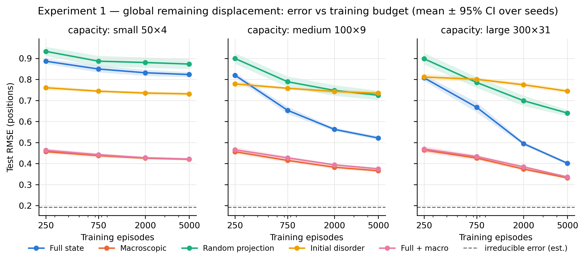

*Figure 1. Global-task test RMSE vs. training budget for each capacity preset (mean ± 95% CI over 10 seeds). Dashed line: estimated irreducible error.*

**Table 1.** Global-task test RMSE (positions; mean ± SD over 10 seeds).

| Capacity | Budget | Full state | Macroscopic | Random proj. | Initial disorder | Full + macro |
| :-- | --: | --: | --: | --: | --: | --: |
| medium | 250 | 0.820 ± 0.017 | 0.456 ± 0.015 | 0.900 ± 0.035 | 0.779 ± 0.019 | 0.466 ± 0.018 |
| medium | 5,000 | 0.521 ± 0.012 | 0.366 ± 0.010 | 0.725 ± 0.031 | 0.734 ± 0.013 | 0.375 ± 0.008 |
| large | 250 | 0.807 ± 0.020 | 0.464 ± 0.017 | 0.898 ± 0.038 | 0.812 ± 0.023 | 0.469 ± 0.020 |
| large | 5,000 | 0.401 ± 0.010 | 0.332 ± 0.007 | 0.640 ± 0.020 | 0.744 ± 0.013 | 0.336 ± 0.008 |
| xlarge | 5,000 | 0.420 ± 0.010 | 0.341 ± 0.010 | 0.644 ± 0.021 | 0.745 ± 0.013 | 0.349 ± 0.008 |
| val.-selected | 250 | 0.807 ± 0.020 | 0.455 ± 0.014 | 0.897 ± 0.036 | 0.760 ± 0.016 | 0.461 ± 0.016 |
| val.-selected | 5,000 | 0.401 ± 0.010 | 0.332 ± 0.007 | 0.641 ± 0.020 | 0.731 ± 0.013 | 0.336 ± 0.008 |

**Table 2.** Paired difference Macroscopic − Full state in test RMSE (10 seeds; macro lower in 10/10 seeds in every row; paired t p < 10⁻⁶, Wilcoxon p = 0.002).

| Setting | Mean diff | 95% CI | Relative |
| :-- | --: | :-- | --: |
| small, 250 | −0.430 | [−0.441, −0.419] | −48.5% |
| medium, 5,000 | −0.156 | [−0.170, −0.142] | −29.9% |
| large, 5,000 | −0.070 | [−0.079, −0.060] | −17.4% |
| xlarge, 5,000 | −0.079 | [−0.091, −0.068] | −18.8% |
| validation-selected, 250 | −0.353 | [−0.369, −0.337] | −43.7% |
| validation-selected, 5,000 | −0.070 | [−0.079, −0.060] | −17.4% |

The macro representation beats the full state in every one of the 130 seed × budget × capacity cells. The advantage is 43–49% at 250 episodes and declines with both budget and capacity to 17% at 5,000 episodes under validation-selected capacity (large for both representations). The raw-state curve is still falling steeply at 5,000 episodes (0.494 → 0.401 from 2,000 to 5,000 at large) while the macro curve is flattening (0.374 → 0.332); both remain far above the 0.192 floor. The xlarge preset is worse than large for every representation, consistent with over-fitting under a fixed learning rate without early stopping; validation selection never chooses it for the macro or full representations.

Controls: the random projection is the worst representation at every budget and capacity (macro − random = −0.30 to −0.48, 46–52% relative, 10/10 seeds), worse than the single disorder scalar at medium capacity. Full + macro is marginally *worse* than macro alone in every cell (by 0.001–0.012; macro lower in 8–10 of 10 seeds). On the shifted split the macro advantage is larger (large/5,000: 0.336 ± 0.014 vs. 0.481 ± 0.021, paired −0.145 [−0.158, −0.132]).

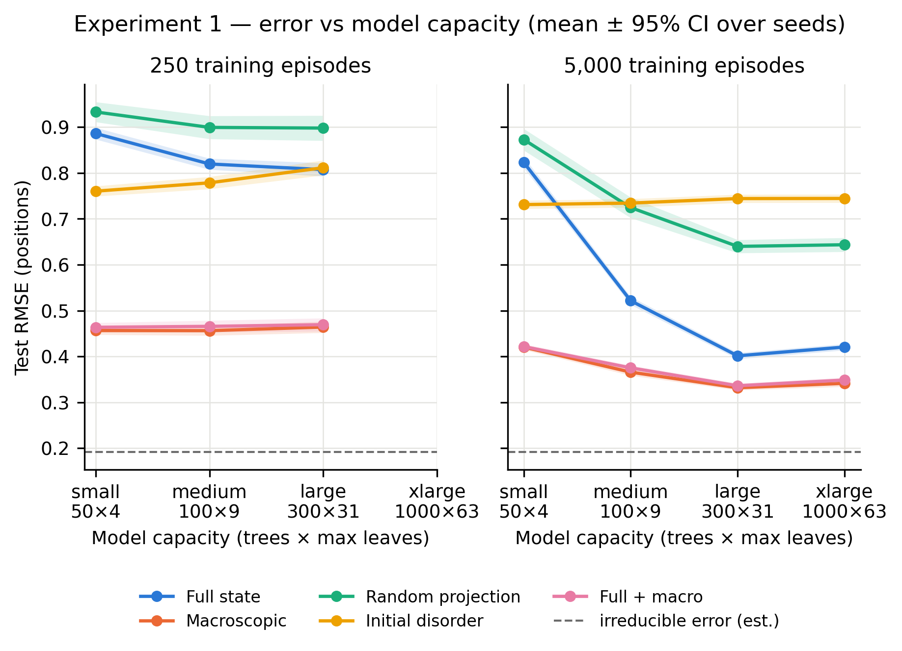

*Figure 2. Test RMSE vs. capacity preset at 250 and 5,000 training episodes.*

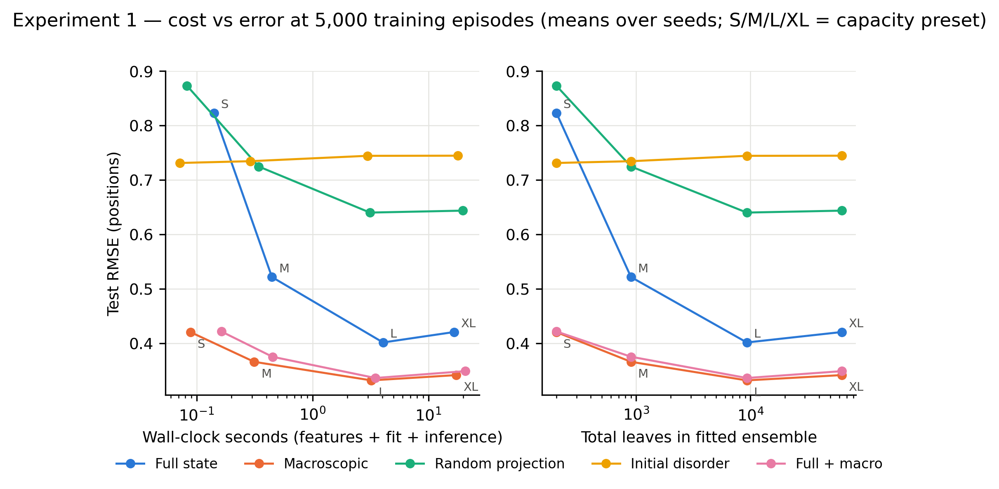

*Figure 3. Test RMSE vs. total wall-clock cost (left) and realised ensemble size (right) at 5,000 episodes.*

Costs: feature extraction is negligible (0.4 ms raw, 2.6 ms macro, 3.1 ms projection per 5,000 episodes). Fit time is set by the preset and secondarily by feature count (medium: 0.44 s full vs. 0.30 s macro; large: 4.03 s vs. 3.20 s). Under compute matching the advantage widens: macro at medium (0.31 s, RMSE 0.366) beats full state at large (4.06 s, RMSE 0.401) at 13× lower cost.

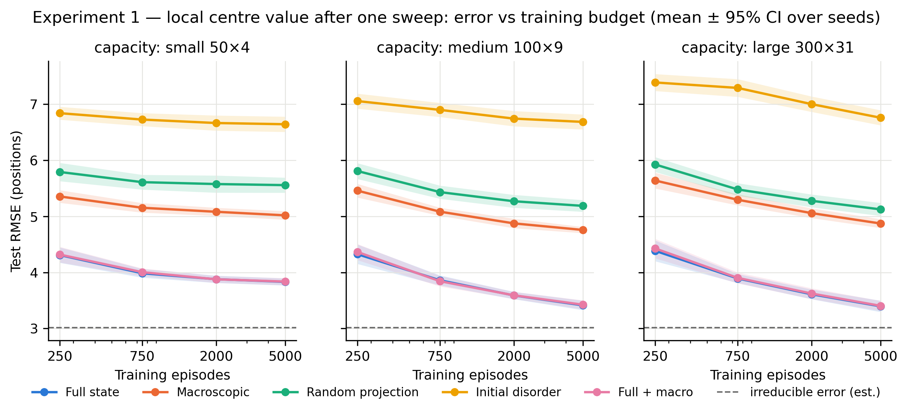

*Figure 4. Local control task: the ranking inverts.*

Local control (centre value after one sweep, medium/5,000): Full state 3.413 ± 0.118, Macroscopic 4.757 ± 0.077, Random projection 5.187 ± 0.146, Initial disorder 6.684 ± 0.186, Full + macro 3.424 ± 0.112; irreducible 3.01. The full state wins in 10/10 seeds at every budget and capacity, and its margin grows with capacity (+24% at small/250 to +43% at large/5,000).

### 8.2 Experiment 2

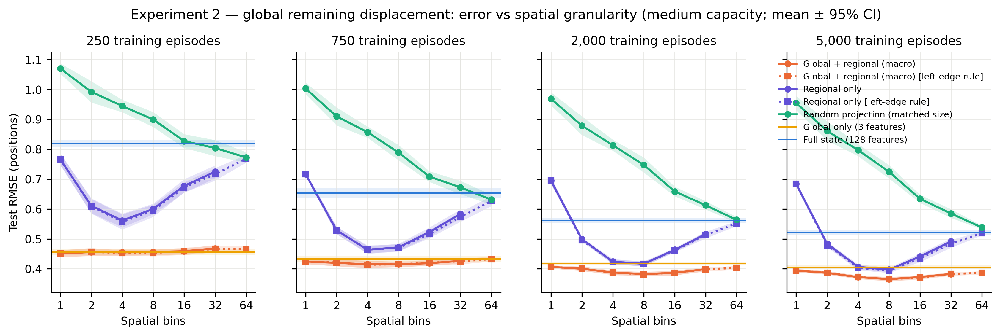

*Figure 5. Test RMSE vs. number of spatial bins at the medium preset, one panel per budget. Lines: macro (global + regional), regional-only, dimension-matched random projection; horizontal bands: global-only and raw references.*

**Table 3.** Test RMSE vs. resolution, medium preset, 5,000 episodes (mean ± SD; feature counts macro / regional / random).

| Bins | Features | Macro | Regional only | Random proj. |
| --: | --: | --: | --: | --: |
| 1 | 6 / 3 / 6 | 0.394 ± 0.008 | 0.684 ± 0.012 | 0.955 ± 0.033 |
| 2 | 9 / 6 / 9 | 0.387 ± 0.008 | 0.484 ± 0.009 | 0.861 ± 0.044 |
| 4 | 15 / 12 / 15 | 0.372 ± 0.008 | 0.407 ± 0.011 | 0.797 ± 0.028 |
| 8 | 27 / 24 / 27 | **0.366 ± 0.010** | **0.397 ± 0.010** | 0.725 ± 0.031 |
| 16 | 51 / 48 / 51 | 0.373 ± 0.009 | 0.441 ± 0.014 | 0.634 ± 0.019 |
| 32 | 99 / 96 / 99 | 0.383 ± 0.007 | 0.492 ± 0.014 | 0.585 ± 0.020 |
| 64 | 195 / 192 / 195 | 0.387 ± 0.008 | 0.519 ± 0.010 | 0.538 ± 0.009 |
| global only | 3 | 0.405 ± 0.009 | | |
| raw | 128 | 0.521 ± 0.012 | | |

Paired against 8 bins at 5,000 episodes, every other macro resolution is worse: 1 bin +0.029 [0.025, 0.032], 4 bins +0.007 [0.003, 0.011], 16 bins +0.007 [0.004, 0.010], 32 bins +0.017 [0.014, 0.021], 64 bins (left rule) +0.021 as a difference of means; global-only +0.040 [0.037, 0.042]; raw +0.156 [0.142, 0.170]. Eight bins is the validation-best resolution in 8/10 seeds (4 bins in the other two). At 250 episodes, by contrast, no resolution differs detectably from 8 bins except 32 (+0.012), the whole sweep lies within 0.451–0.468, and 1 bin is the validation-best choice in 4/10 seeds (7/10 at the small preset).

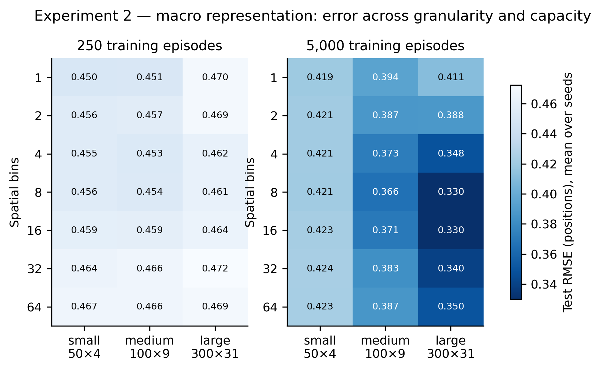

*Figure 6. Macro test RMSE across resolution and capacity at 250 and 5,000 episodes.*

Granularity × capacity: at 250 episodes every cell lies in 0.450–0.472. At 5,000, the small preset is flat (0.419–0.424), medium is minimal at 8 bins, and large is minimal at 8–16 bins (0.330 / 0.330; 1 bin 0.411, 64 bins 0.350). The optimal resolution moves finer as resources grow.

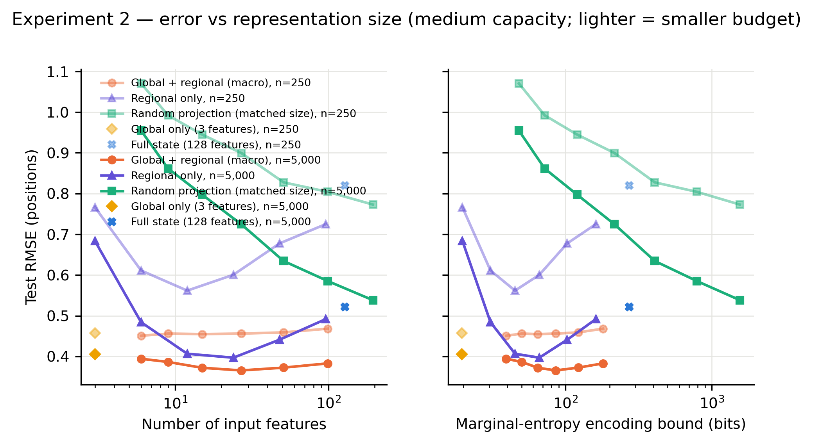

*Figure 7. Test RMSE vs. feature count (left) and marginal-entropy encoding bound (right).*

Ablations: the three global statistics alone reach 0.405, within 10% of the best model and 0.12 better than the raw state. The regional-only series has a pronounced interior optimum (0.684 at 1 bin, 0.397 at 8, 0.519 at 64). Permutation importance of the 8-bin model is dominated by the displacement × unreliability interaction (0.932 ± 0.030 RMSE increase when permuted) and mean displacement (0.130 ± 0.013); every regional feature contributes ≤ 0.01. The random projection improves monotonically with dimension and reaches the raw state's level only at 195 dimensions. The 64-bin macro representation has a larger entropy bound (314 bits) than the raw state (273 bits) yet 26% lower error.

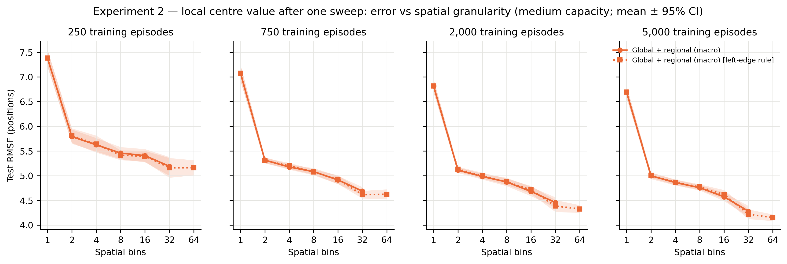

*Figure 8. Local control task vs. resolution: finer is monotonically better.*

Local control (macro, medium, 5,000): 6.70 at 1 bin, 4.76 at 8, 4.15 at 64; 32 or 64 bins is validation-best in 10/10 seeds; all remain far above the raw state (3.41). Costs grow mildly with feature count (fit 0.19–0.27 s for engineered sets vs. 0.32 s raw and 0.47 s for the 195-dimensional projection; extraction ≤ 3.7 ms).

### 8.3 Experiment 2b

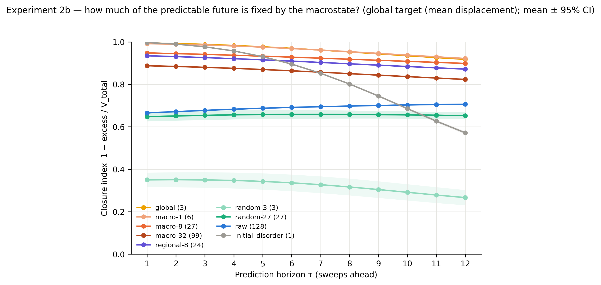

*Figure 9. Closure index vs. prediction horizon for the global target (mean ± 95% CI over 10 seeds). A value of 1 means configurations matched on the abstraction have identical conditional-mean futures.*

**Table 4.** Closure index at τ = 12 (target), 10,000 configurations, mean over 10 seeds (SD ≤ 0.004 unless shown).

| Abstraction | Features | Rel. neighbour distance | Closure | Matched-size random projection |
| :-- | --: | --: | --: | --: |
| Initial disorder | 1 | 0.001 | 0.572 | |
| Global | 3 | 0.040 | **0.918** | 0.266 (± 0.06) |
| Macro-1 | 6 | 0.082 | 0.922 | 0.449 |
| Macro-8 | 27 | 0.292 | 0.899 | 0.653 |
| Regional-8 | 24 | 0.296 | 0.872 | |
| Macro-32 | 99 | 0.470 | 0.823 | 0.686 |
| Raw state | 128 | 0.460 | 0.706 | |

Configurations matched on the three global summaries, at a relative neighbour distance of 0.04, have futures twelve sweeps ahead whose true conditional means agree to within 8% of their variance (V_total = 1.199 ± 0.025 positions²; V_irr = 0.031). Paired against controls: global − random-3 = +0.652 [0.614, 0.689]; macro-8 − random-27 = +0.246 [0.230, 0.262]; global − initial disorder = +0.347 [0.339, 0.354]; all 10/10 seeds. Measuring the future by the three global summaries instead of the target gives global closure 0.929 and initial disorder 0.545. Closure of the global summaries falls slowly with horizon (0.995 at τ = 1); the disorder scalar is almost closed at τ = 1 (0.997) and collapses to 0.572 by τ = 12, because the long-horizon recovery depends on where the disorder sits relative to the unreliable region, which only the interaction feature carries.

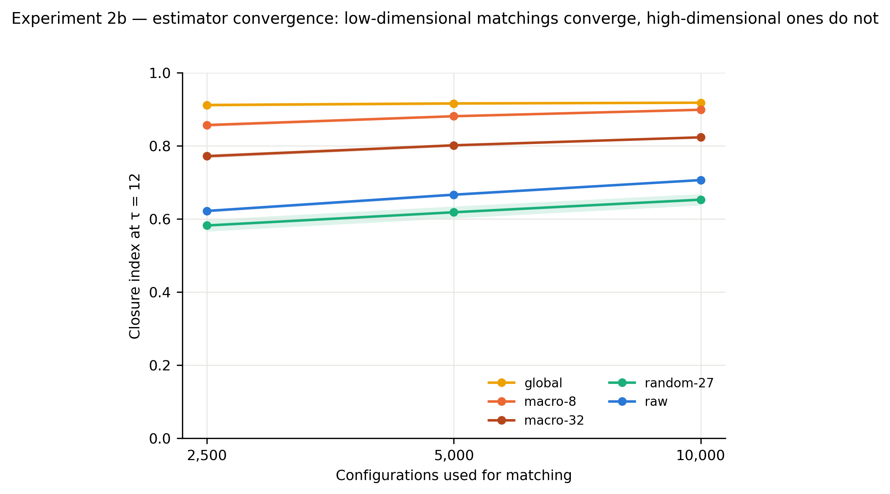

*Figure 10. Estimator convergence with the number of configurations.*

The estimator has converged for low-dimensional abstractions (global 0.912 → 0.916 → 0.918 at 2,500 → 5,000 → 10,000) and not for high-dimensional ones (macro-8 0.857 → 0.881 → 0.899; raw 0.622 → 0.666 → 0.706). The ordering macro-8 < global, although macro-8 contains strictly more information, is therefore a finite-sample matching artefact; only matched-size comparisons are interpretable, and the high-dimensional values are lower bounds.

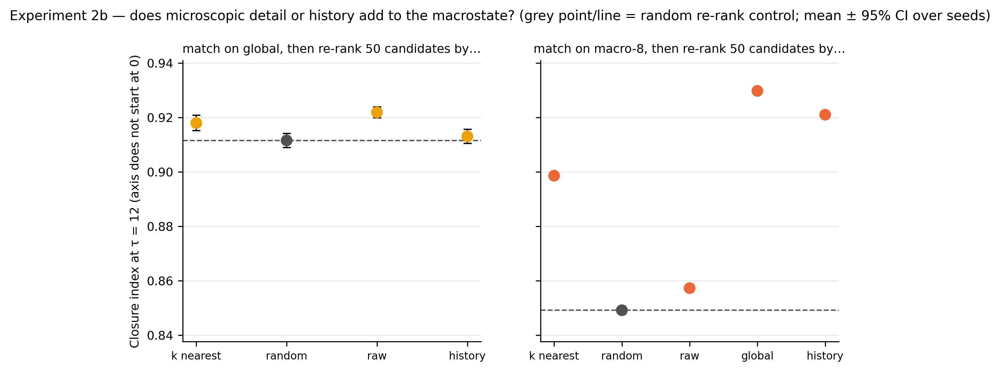

*Figure 11. Closure after re-ranking the 50 nearest macro-neighbours by raw-state distance, by the previous sweep's global summaries, by the present global summaries, or at random.*

Re-ranking the global-matched candidates by raw-state distance raises closure by +0.0103 [0.0094, 0.0112] over the random re-rank control (10/10 seeds); re-ranking by the previous macrostate raises it by +0.0015 [0.0005, 0.0025]. At the macro-8 level, present-global re-ranking (+0.081 over random) does as much as history re-ranking (+0.072), and history is slightly worse than present-global (−0.009 [−0.009, −0.008]): the gain from history is tighter matching of the present macrostate, not memory.

## 9. Discussion

Throughout this section we distinguish **established findings** (reproducible results of §8 or theorems), **interpretations** (our explanations of them), **hypotheses** (mechanisms not yet tested) and **inspirations** (ideas that motivate the programme without being evidence for it).

### 9.1 The baseline finding survives, in a qualified form (finding and interpretation)

Ten seeds, four capacities and validation-based selection all agree that the engineered macroscopic representation lowers the error a gradient-boosting learner attains on the global target, with a consistency (130/130 cells, every seed) that leaves no room for a seed artefact. But the size of the effect is a strong function of resources: it is roughly halved error at 250 episodes and a 17% reduction at 5,000 episodes with the larger model. The raw-state curve has not converged, and both curves sit far above the noise floor, so the data are consistent with the information-ordering argument that the gap closes in the limit. The claim supported is therefore not that the summary is better in an absolute sense but that it buys a large head start for a bounded learner, a head start that is worth more when the learner is more constrained and that is larger still under compute matching.

### 9.2 It is the content, not the compression (finding and interpretation)

Three results separate the effect of *what* is kept from the effect of *how much* is kept. The dimension-matched random projection is harmful at every size, worse than the raw state and worse even than a single scalar. Three global numbers capture most of the benefit, and one engineered interaction carries most of the predictive weight. And a 195-feature engineered representation with a larger encoding cost than the raw state still beats it by a wide margin. A reading of these experiments as evidence that "throwing information away" helps would be wrong; the engineered features re-express the state in coordinates (displacement relative to the known goal configuration, unreliability where displaced elements sit) in which the target is a simple function. In the vocabulary of §1, this is the difference between compression and abstraction, and the data come down on the side of abstraction: the useful representations are those that preserve the *relationship* between misplaced elements and unreliable edges, whatever their size.

### 9.3 Coarse-graining has a real but modest, resource-dependent effect (finding and interpretation)

With the global features present, the resolution sweep shows a shallow interior optimum at 8–16 bins that is absent at 250 episodes and moves finer as data and capacity grow, the pattern expected from a bias–variance trade-off. The regional-only ablation shows the same trade-off in sharper form: 64-bin features contain strictly more information than 8-bin features and are learned strictly worse at every budget. This is the one place where "less is more" holds in its literal sense, and it holds for a bounded learner on a fixed budget, not for information content.

### 9.4 Task dependence and the limits of compression (finding, interpretation and counterargument)

The local target reverses every ranking: the raw state wins in every seed, the finest resolution is best, and the raw state's margin grows with capacity. A representation is useful relative to a prediction target, and no amount of resource gives the macro summary back the element identities it discarded. This is the empirical form of a general counterargument to any "less is more" thesis. Not every target admits a compact representation; some outcomes depend irreducibly on microscopic detail (here, which element sits next to which); and even when a compact law exists, prediction from it can be expensive, as chaos and computational irreducibility illustrate [21]. The same point separates *possessing* a representation of a problem from *solving* it efficiently; complexity theory makes the distinction precise [27], but nothing here bears on asymptotic complexity or on P versus NP. What our experiments show is only that a good representation can make structured instances easier for a practical learner under practical budgets. There is no universally optimal representation in our system, and we see no reason to expect one elsewhere. The hypothesis we are pursuing is therefore not that less information is better, but that a capable system must determine *which* distinctions matter for the task at hand and spend its limited resources on those, keeping full detail, keeping a summary, or keeping several levels at once as the task requires. Whether abstraction is *the* central mechanism of intelligence or one of several interacting mechanisms (search, memory, exploration, planning, feedback-driven learning) is an open question that our data do not address; the local task is a reminder that a system that only abstracts would be as handicapped as one that only remembers.

### 9.5 From predictive coarse-graining to abstraction-based intelligence (interpretation and hypothesis)

Why should an improvement in resource-bounded prediction from supplied features motivate research into autonomous abstraction? Because it establishes the first link in a chain and measures its size. The progression we have in mind is:

1. **Useful supplied abstraction.** A representation designed with task knowledge reduces the data and compute a learner needs. *Investigated here*: the effect exists, is large under scarcity, shrinks with resources, is driven by content rather than size, and is task-specific.
2. **Autonomous abstraction discovery.** A system constructs such a representation from raw observations without being told which features matter. *Not investigated.* The ablations sharpen what success would look like: a learned three-dimensional bottleneck that reached the global-only error of 0.405 at 5,000 episodes, and whose coordinates were linearly readable as displacement, descent fraction and the displacement–unreliability interaction, would be a discovery of the relevant abstraction in this system. Ho et al. [20] show that people do something of this kind when planning; whether a learner can do it with as few examples as it then needs to use the abstraction is the open question, and the discovery cost must be charged against the savings.
3. **Transfer to unseen situations.** A representation learned in one family of environments reduces the data needed in a structurally related one. *Not investigated.* Our seeds are draws from one simulator; our shifted split changes only the fault distribution. Structure-mapping theory [24] suggests what should transfer, relations like "disorder overlapping unreliability" rather than attributes like array length, and transfer learning [25] supplies the controls (surface-feature overlap, pre-training cost, negative transfer).
4. **Task-dependent adaptation.** The system recognizes that a previously adequate representation has become insufficient and revises or expands it. *Not investigated*, but the local task shows that the failure mode is real: a system committed to the macro summary would be 39% worse than one with the raw state on the local target and would not improve with capacity.

The conceptual progression *information availability → useful representation → efficient prediction → generalization and transfer* maps onto these stages. Our experiments show that the second and third are distinct from the first (the raw state has all the information and predicts worst), and that the second depends on the task. They say nothing yet about the fourth.

### 9.6 Emergent structure and predictive abstraction (finding, interpretation and hypothesis)

The features that work in this system describe collective properties of the array: how far elements are from their goal positions on average, how often neighbours are inverted, and where the disorder overlaps the unreliable region. These are aggregate quantities produced by many local interactions, and the target, the array's global recovery, is itself a collective outcome. Experiments 1–2 could not say whether their predictive success reflects something about the *system*, namely that the sorting dynamics approximately close over a few collective variables, or only something about the *learner*, namely that we chose coordinates in which a tree ensemble finds the target easy. The distinction is operational. Write X_t for the microstate, Z_t = φ(X_t) for a macroscopic abstraction and τ for a horizon. A macroscopic description is approximately autonomous at horizon τ when

P(Z_{t+τ} | X_t) ≈ P(Z_{t+τ} | Z_t),

that is, when the microscopic details left out of Z_t contribute little additional information about the future macrostate; in information terms, I(Z_{t+τ}; X_t | Z_t) ≈ 0 [34, 36]. Experiment 2b measures a finite-sample proxy for this, without a learner, and the answer is that **the three global summaries are an approximately autonomous level of description for the global target in this system** (finding). Matched on three numbers, configurations have futures twelve sweeps ahead whose conditional means agree to within 8% of their variance; a matched random projection reaches 27%, and the disorder scalar alone 57%, so what closes is not sortedness in general but the specific combination that includes the disorder–unreliability interaction. The residual 8% is an upper bound on what the microstate adds: re-ranking matched configurations by raw-state distance recovers about one point of it, and re-ranking by the previous macrostate recovers essentially nothing, so the coarse-grained dynamics are approximately Markov in the instantaneous global state (interpretation; the raw re-ranking is itself a lower bound on the microscopic contribution, because nearest raw neighbours in 128 dimensions remain far apart).

This changes the status of the "convenient coordinates" alternative. It is no longer sufficient as an explanation of Experiments 1–2: the variables that make the learner efficient are also the variables over which the dynamics close, and a learner that found them would be finding a property of the system. It does not, however, settle the other caveats. The criterion is horizon- and distribution-dependent, and we measured it for horizons up to 12 and for configurations drawn from the episode distribution after two sweeps only. It concerns the future *macrostate*: the local target is not closed over any coarse representation, as Experiments 1–2 show, and no closure result changes that. It is observational, and establishes no causal emergence in the sense of [28] and no ontological claim. The features remain supplied, so nothing is implied about discovery. And the estimator is a nearest-neighbour approximation that is converged for three to six dimensions and biased downward above, which is why comparisons across dimensionality are made only at matched size.

Several alternative explanations of the learning results remain live and are now sharper. The features encode substantial prior knowledge of the simulator, including the goal configuration. The learner's advantage may still be partly inductive bias (axis-aligned splits on well-chosen coordinates); a locality-aware architecture on the raw state is the untested competitor, and the closure result predicts that such a model would have to *reconstruct* these three quantities to match the macro learner, which is a testable prediction for Experiment 3. The useful level depends on task and horizon. And some systems admit no useful low-dimensional coarse-grained dynamics at all; this one does, which is a fact about this system rather than about complex systems in general.

### 9.7 Relation to prior frameworks

Our results are consistent with the information-bottleneck view that task-relevant compression is what matters, and with the computational-mechanics intuition that a few well-chosen statistics can be nearly sufficient for a process's future. They do not estimate mutual information, do not identify causal states, do not measure closure, and do not exhibit causal emergence in the sense of [7, 8, 28]. They do not measure intelligence in Chollet's sense [13]: we vary experience (budget) and capacity but hold the task fixed and supply the prior. They also say nothing about autonomous discovery: every representation here was supplied.

## 10. Limitations and threats to validity

- **One learner family, one capacity axis.** Only histogram gradient boosting was used, varying trees and leaves. A locality-aware neural model on the raw state could close the gap; this is the most important missing control and was pre-registered as future work.
- **Over-fitting of the largest preset.** The xlarge preset is worse than large for all representations under a fixed learning rate without early stopping, so the raw state's best achievable error within this learner family is not pinned down. Validation selection mitigates but does not remove this concern.
- **Oracle features and unmeasured construction cost.** The macro features encode the sorted goal configuration and the fault profile, and the human effort of designing them is not accounted for. The experiments test supplied abstractions.
- **Synthetic, narrow data-generating process.** Training and test data are generated by the same code; the shifted split changes fault width and severity only. No external validity is claimed, and nothing here models human cognition.
- **Size proxies are bounds.** The marginal-entropy bound and effective rank are not information-theoretic measurements of relevance.
- **Timing.** Single-machine wall-clock numbers under default multithreading; feature extraction is cheap here because the features are O(N), which need not hold for other engineered summaries.
- **Ten seeds.** Enough to resolve the effects observed (all CIs exclude zero); the original plan called for twenty.
- **Multiple comparisons.** Many paired tests are reported; the primary conclusions rest on effects that are large relative to their intervals and consistent across all seeds, not on borderline p-values.
- **Closure estimator.** Nearest-neighbour matching is converged for three to six dimensions and biased downward above; the closure values for macro-8 and the raw state are lower bounds, and closure was measured for one configuration distribution, horizons to 12 and one history depth.
- **Conflations to avoid.** Prediction accuracy is not transferability and neither is intelligence; dimensionality is not information; success across seeds is not transfer; predictive usefulness of a macroscopic variable is not dynamical autonomy (Experiment 2b measures the latter separately), and approximate predictive sufficiency is not causal emergence.

## 11. Future work

### 11.1 An illustrative operational framework

To organize the programme, not to define intelligence, it is useful to write the quantities involved. Let X be an observed situation, T the current task, H prior experience, Z = f(X, T, H) a constructed representation, and Y the outcome to be predicted. One can describe representation learning as the trade-off

min over f, g of E[ℒ(g(Z, T), Y)] + λ C(f, g) + β R(Z),

where ℒ is task loss, C the cost of constructing and using the representation, and R its complexity. Special cases are familiar: with R = I(X;Z), λ = 0 and ℒ chosen as a log-loss, this is the information bottleneck [2]; with C the planning cost and ℒ the value loss, it is close to Abel's desiderata [15]; rate–distortion theory is the case without a downstream task. Our experiments vary the data available to estimate the expectation and the capacity of g, and measure C for fixed f. *Transfer* adds a second dimension: whether an f learned in environment A reduces the data or compute needed to reach a given loss in a structurally related environment B, net of the cost of learning f. *Adaptation* adds a third: how quickly a system detects that Z is inadequate for a new T and how much it costs to revise f. Chollet's skill-acquisition efficiency [13] is a normalization of exactly these quantities by prior H and experience. We regard the expression as a bookkeeping device; it is not a measurement, and we do not propose to optimize it directly.

### 11.2 Experiment 3 — Autonomous abstraction discovery (not started)

Train a small encoder on the raw 128-dimensional state with a bottleneck of 3, 8 or 27 dimensions, end-to-end on the global target, on the same episodes and budgets as Experiments 1–2, with capacity control (noise injection or a variational bottleneck [10]) so that the bottleneck's information content is bounded, not merely its dimension. Controls: a random encoder of the same size (we already know random linear projections fail), an autoencoder trained for reconstruction, and the supplied features. **Smallest falsification test:** at 5,000 episodes, does the learned 3-dimensional bottleneck reach the global-only error (0.405 ± 0.009), and do linear probes recover the displacement–unreliability interaction from it (R² ≥ 0.9)? Experiment 2b adds a second criterion: the learned bottleneck's closure index at τ = 12, computed exactly as in §7b, should approach that of the supplied global summaries (0.918). If the learned bottleneck is no better than the raw state at any budget, or recovers displacement but not the interaction, the hypothesis that this system's relevant abstraction is discoverable by a small learner fails at this scale. The learning cost of the encoder must be charged against the savings.

### 11.3 Experiment 4 — Abstraction transfer (not started)

Learn an encoder on one family of environments (array length 64, horizon 12, the present fault model) and test whether it reduces the data needed in a structurally related but unseen family: different array length, different horizon, a different local rule (for example insertion-style exchanges), or a different fault geometry. Compare frozen and fine-tuned encoders against learning from scratch at every budget. Controls: a *surface-feature* control in which positions are relabelled so that attribute overlap is destroyed while relational structure is kept (transfer should survive); a *negative-transfer* control in which the target family is built so that the source abstraction is misleading (for example reliability affects speed but not final order); and full accounting of pre-training cost. **Smallest falsification test:** with 250 target-family episodes, does the transferred encoder reach the error that learning from scratch needs 2,000 episodes to reach, and does the surface-feature control preserve that gain? Success across seeds of the present simulator does not count.

### 11.4 Experiment 5 — Adaptive abstraction (not started)

Train a system on the global target, then switch the objective to the local target (or to a global target with a different horizon) without announcing the switch. Give the system a representation menu (macro at several resolutions, raw, their union) and a validation-driven selector, or a learned gate. Measure how many post-switch episodes it needs to detect the degradation and to move to a representation within 5% of the best available, and compare with retraining from scratch. Controls: a system that never adapts (we know from §8 it would be 39% worse on the local target), and a switch to a task for which the old abstraction remains adequate (false-alarm rate). **Smallest falsification test:** if detection plus re-selection costs more episodes than retraining from scratch on the new task, adaptation of the kind hypothesized is not cheaper than relearning in this system.

### 11.5 Extensions of the closure test (Experiment 2b executed; §7b, §8.3)

The closure test as run covers one episode distribution (advanced by two sweeps), horizons to 12, one history depth and two future measures. Its natural extensions are: closure over configurations drawn late in recovery and over the shifted fault distribution; longer horizons, to find where the global summaries stop closing; richer histories (several sweeps, the full macro vector), to confirm the Markov property beyond one step; array lengths other than 64 and other disturbance types, to see whether the same three variables close elsewhere, which is the system-side counterpart of the transfer question; and a closure test for the *local* target, which we expect to fail for every coarse representation and which would make the task dependence of emergence explicit. A dimension-fair estimator remains an open methodological need; at this sample size the plain nearest-neighbour estimator is a lower bound above six dimensions.

### 11.6 Nearer-term controls

Before any submission the raw state should be given a locality-aware architecture with a fair tuning budget, the largest boosting models should be tuned (learning rate, early stopping), and the horizon should be varied to test whether the optimal scale depends on it.

## 12. Conclusion

In a stochastic local-sorting system, a hand-engineered macroscopic representation lets a gradient-boosting learner predict global recovery with reliably lower error than the complete microscopic state, across ten seeds, four training budgets and four capacity settings, with the advantage ranging from roughly half the error at 250 episodes to 17% at 5,000 episodes under validation-selected capacity. The effect is an inductive bias that pays off most when resources are scarce, not an information gain; it stems mainly from a few task-relevant global statistics rather than from spatial coarse-graining; and it reverses for a target that depends on local detail. Coarse-graining itself produces a shallow optimum at intermediate resolution that disappears at small budgets and shifts finer with resources.

The broader significance, stated with the qualifications of §9 and §10, is that these results make concrete and measurable the first step in a progression from compression to abstraction, from abstraction to generalization, and from generalization to transfer and adaptation. They show, in one system, that having information is not the same as being able to use it, that what makes a representation useful is the structure it preserves rather than the amount it discards, and that the right structure depends on the question. Whether that structure is a property of the system or only a convenient set of coordinates for one learner is a separate and measurable question, and here it has an answer: configurations that agree on the three global summaries agree on their macroscopic future to within 8% of its variance, with no help from the past and little from microscopic detail, so the sorting dynamics approximately close over the variables the learner found useful. Whether a system can find such structure on its own, carry it to situations it has not seen, and give it up when it stops working, remains to be tested; the experiments proposed in §11 are the smallest we can think of that could show it cannot.

## Data and code availability

All code, raw per-fit records (`results/experiment*/raw/`), summary CSVs, figures and the frozen single-seed baseline are in the repository. Reproduce with `uv sync`, then `uv run macro-experiment1 --output results/experiment1`, `uv run macro-experiment2 --output results/experiment2`, `uv run macro-experiment2b --output results/experiment2b` and `uv run macro-analyze --experiment1 results/experiment1 --experiment2 results/experiment2 --experiment2b results/experiment2b`. Software: Python 3.13, NumPy 2.3.5, scikit-learn 1.8.0, SciPy 1.18.1, pandas 3.1.1, Matplotlib 3.10.8; `uv.lock` pins the environment.

## References

1. Zhang, T., Goldstein, A., & Levin, M. (2025). Classical sorting algorithms as a model of morphogenesis: Self-sorting arrays reveal unexpected competencies in a minimal model of basal intelligence. *Adaptive Behavior*, 33(1), 25–54. <https://doi.org/10.1177/10597123241269740>
2. Tishby, N., Pereira, F. C., & Bialek, W. (1999). The information bottleneck method. *Proc. 37th Allerton Conference on Communication, Control and Computing*, 368–377. arXiv:physics/0004057.
3. Shalizi, C. R., & Crutchfield, J. P. (2001). Computational mechanics: Pattern and prediction, structure and simplicity. *Journal of Statistical Physics*, 104(3–4), 817–879.
4. Still, S., Crutchfield, J. P., & Ellison, C. J. (2010). Optimal causal inference: Estimating stored information and approximating causal architecture. *Chaos*, 20(3), 037111.
5. Bialek, W., Nemenman, I., & Tishby, N. (2001). Predictability, complexity, and learning. *Neural Computation*, 13(11), 2409–2463.
6. Koch-Janusz, M., & Ringel, Z. (2018). Mutual information, neural networks and the renormalization group. *Nature Physics*, 14(6), 578–582.
7. Hoel, E. P., Albantakis, L., & Tononi, G. (2013). Quantifying causal emergence shows that macro can beat micro. *PNAS*, 110(49), 19790–19795.
8. Rosas, F. E., Mediano, P. A. M., Jensen, H. J., Seth, A. K., Barrett, A. B., Carhart-Harris, R. L., & Bor, D. (2020). Reconciling emergences: An information-theoretic approach to identify causal emergence in multivariate data. *PLOS Computational Biology*, 16(12), e1008289.
9. Grinsztajn, L., Oyallon, E., & Varoquaux, G. (2022). Why do tree-based models still outperform deep learning on typical tabular data? *NeurIPS 2022, Datasets and Benchmarks Track*. arXiv:2207.08815.
10. Alemi, A. A., Fischer, I., Dillon, J. V., & Murphy, K. (2017). Deep variational information bottleneck. *ICLR 2017*. arXiv:1612.00410.
11. Ke, G., Meng, Q., Finley, T., Wang, T., Chen, W., Ma, W., Ye, Q., & Liu, T.-Y. (2017). LightGBM: A highly efficient gradient boosting decision tree. *NeurIPS 30*, 3146–3154.
12. Bingham, E., & Mannila, H. (2001). Random projection in dimensionality reduction: Applications to image and text data. *KDD 2001*, 245–250.
13. Chollet, F. (2019). On the measure of intelligence. arXiv:1911.01547.
14. Borges, J. L. (1998). *Collected Fictions* (A. Hurley, Trans.). Penguin. "Funes, His Memory" (1942) and "The Library of Babel" (1941), originally in *Ficciones*.
15. Abel, D. (2020). *A theory of abstraction in reinforcement learning*. PhD thesis, Brown University. arXiv:2203.00397.
16. Kadanoff, L. P. (1966). Scaling laws for Ising models near T_c. *Physics Physique Fizika*, 2(6), 263–272.
17. Li, L., Walsh, T. J., & Littman, M. L. (2006). Towards a unified theory of state abstraction for MDPs. *ISAIM 2006*, 531–539.
18. Ferns, N., Panangaden, P., & Precup, D. (2004). Metrics for finite Markov decision processes. *UAI 2004*, 162–169.
19. Littman, M. L., & Sutton, R. S. (2002). Predictive representations of state. *NIPS 14*.
20. Ho, M. K., Abel, D., Correa, C. G., Littman, M. L., Cohen, J. D., & Griffiths, T. L. (2022). People construct simplified mental representations to plan. *Nature*, 606(7912), 129–136.
21. Wolfram, S. (1985). Undecidability and intractability in theoretical physics. *Physical Review Letters*, 54(8), 735–738.
22. Levin, M. (2019). The computational boundary of a "self": Developmental bioelectricity drives multicellularity and scale-free cognition. *Frontiers in Psychology*, 10, 2688.
23. Cavagna, A., Cimarelli, A., Giardina, I., Parisi, G., Santagati, R., Stefanini, F., & Viale, M. (2010). Scale-free correlations in starling flocks. *PNAS*, 107(26), 11865–11870.
24. Gentner, D. (1983). Structure-mapping: A theoretical framework for analogy. *Cognitive Science*, 7(2), 155–170.
25. Pan, S. J., & Yang, Q. (2010). A survey on transfer learning. *IEEE Transactions on Knowledge and Data Engineering*, 22(10), 1345–1359.
26. Pedregosa, F., et al. (2011). Scikit-learn: Machine learning in Python. *Journal of Machine Learning Research*, 12, 2825–2830.
27. Aaronson, S. (2013). Why philosophers should care about computational complexity. In B. J. Copeland, C. J. Posy, & O. Shagrir (Eds.), *Computability: Turing, Gödel, Church, and Beyond*. MIT Press. arXiv:1108.1791.
28. Hoel, E. P. (2017). When the map is better than the territory. *Entropy*, 19(5), 188.
29. Dewhurst, J. (2021). Causal emergence from effective information: Neither causal nor emergent? *Thought: A Journal of Philosophy*, 10(3), 158–168.
30. Eberhardt, F., & Lee, L. L. (2022). Causal emergence: When distortions in a map obscure the territory. *Philosophies*, 7(2), 30.
31. Israeli, N., & Goldenfeld, N. (2006). Coarse-graining of cellular automata, emergence, and the predictability of complex systems. *Physical Review E*, 73, 026203.
32. Shalizi, C. R., & Moore, C. (2003). What is a macrostate? Subjective observations and objective dynamics. arXiv:cond-mat/0303625.
33. Crutchfield, J. P. (2012). Between order and chaos. *Nature Physics*, 8, 17–24.
34. Pfante, O., Bertschinger, N., Olbrich, E., Ay, N., & Jost, J. (2014). Comparison between different methods of level identification. *Advances in Complex Systems*, 17(2), 1450007.
35. Seth, A. K. (2010). Measuring autonomy and emergence via Granger causality. *Artificial Life*, 16(2), 179–196.
36. Kemeny, J. G., & Snell, J. L. (1976). *Finite Markov Chains*. Springer (originally Van Nostrand, 1960).
37. Levin, M. (2022). Technological approach to mind everywhere: An experimentally-grounded framework for understanding diverse bodies and minds. *Frontiers in Systems Neuroscience*, 16, 768201.
